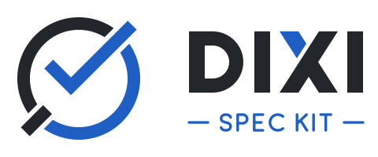

<p align="center">
  <picture>
    <source media="(prefers-color-scheme: dark)" srcset="docs/assets/logo-dark.svg">
    
  </picture>
</p>

<p align="center">
  <a href="https://pypi.org/project/dixi-spec-kit/"></a>
  <a href="https://pypi.org/project/dixi-spec-kit/"></a>
  <a href="https://github.com/dixi-project/dixi-spec-kit/actions/workflows/verify.yml"></a>
  <a href="LICENSE"></a>
</p>

# DIXI Spec Kit

[English](README.md) · **Español** · [Sitio de documentación](https://dixi-project.github.io/dixi-spec-kit/)

## Propósito

DIXI Spec Kit es una herramienta de [Dixi Project](https://github.com/dixi-project) para desarrollar software guiado por especificaciones (SDD) con trazabilidad y verificación: de la idea a specs enlazadas, pruebas primero, código verificado y revisión humana. Incluye una CLI (`dixi`) y comandos para Claude Code.

- **Trazabilidad explícita:** objetivo → dominio → módulo → feature → contrato → prueba, con IDs que `dixi check` comprueba.
- **Pruebas primero y congeladas:** los comandos instruyen escribir pruebas en rojo antes del código y no tocarlas para hacerlo pasar.
- **Control humano:** el agente no firma, no aprueba, no integra y no despliega.
- **Sin dependencias ni red:** la CLI usa solo la biblioteca estándar de Python, no consume IA y no pide credenciales. El lenguaje de tu proyecto lo eliges tú.

## Instalación

Requisitos: Python 3.11 o superior, macOS o Linux. En Windows, usa WSL 2 con el proyecto bajo `~`, no en `/mnt/c` ([detalles](docs/local-development.md#windows-wsl-2)); Windows nativo no está soportado.

```sh
uv tool install dixi-spec-kit
# o
pipx install dixi-spec-kit
```

El paquete está en [PyPI](https://pypi.org/project/dixi-spec-kit/). Para fijar una etiqueta desde Git: `uv tool install git+https://github.com/dixi-project/dixi-spec-kit@v1.11.0`. Sin acceso a PyPI, descarga el wheel de la [release v1.11.0](https://github.com/dixi-project/dixi-spec-kit/releases/tag/v1.11.0) e instálalo con `pipx install dixi_spec_kit-1.11.0-py3-none-any.whl`.

## Inicio rápido

```sh
dixi --lang es init mi-proyecto --agent claude   # o --agent none para usarlo sin agente
cd mi-proyecto
dixi doctor
dixi check
make verify
```

Abre Claude Code en `mi-proyecto` y recorre:

```text
/dixi.discover <tu idea>
/dixi.specify <funcionalidad>
/dixi.clarify <ID de la spec>
/dixi.plan <FEATURE-ID>
/dixi.tasks <FEATURE-ID>
/dixi.build <T-ID>
/dixi.verify
/dixi.review main
```

`/dixi.constitution` fija los principios versionados del proyecto, que lee cada operación; `/dixi.checklist` prueba la calidad de los requisitos de una feature antes de construir; `/dixi.converge` compara el código con sus specs y añade lo que falta como tareas. En proyectos existentes, `/dixi.onboard` redacta borradores de módulos y features a partir del código para que los valides; `/dixi.bugfix` corrige un bug con una prueba en rojo commiteada primero y un registro trazado; `/dixi.issues` publica las tareas de una feature como issues de GitHub con `gh`, después de que confirmes una vista previa. `/dixi.analyze` revisa coherencia e impacto de un cambio; `/dixi.status` indica el siguiente paso. Diseña con `/dixi.domain`, `/dixi.architecture`, `/dixi.contract` y `/dixi.threat-model`; propone cambios con `/dixi.change`; deja un traspaso con `/dixi.handoff`. `/dixi.interview` llena los huecos `{{pending: …}}` con una pregunta a la vez y `/dixi.risk-review` prepara una revisión basada en riesgo; los subagentes `dixi-architect`, `dixi-tester`, `dixi-developer` y `dixi-reviewer` viven en `.claude/agents/`. Operaciones especializadas: `/dixi.data`, `/dixi.quality`, `/dixi.ai`, `/dixi.release`, `/dixi.promote`, `/dixi.operate`, `/dixi.finops`, `/dixi.compliance` y `/dixi.duediligence` solo escriben documentos; nunca ejecutan migraciones, despliegan, cambian `MODE` ni declaran certificaciones. Sin `--lang es`, documentos y mensajes salen en inglés; dentro de un proyecto, los mensajes siguen su idioma.

La [guía de comandos](docs/command-catalog.es.md) traza el recorrido, dice qué comando usar y cuándo, y sigue un ejemplo pequeño de `dixi init` a una versión. Cada comando tiene su página en la [referencia de comandos](docs/commands/index.es.md): qué hace, cuándo usarlo, qué lee y escribe, dónde se detiene y cómo invocarlo desde Claude Code, Codex o Agent Skills.

## Perfiles

`dixi init` instala por defecto una base documental mínima. Elige un perfil para recibir también estándares, guías y plantillas de gobierno, negocio, datos, arquitectura, ingeniería, calidad, seguridad, observabilidad, entrega, operación, producto, UX, IA, FinOps, investigación, crecimiento y éxito del cliente:

| Perfil | Para | Añade |
|---|---|---|
| `minimal` (por defecto) | Probar el método o añadir documentos a mano | Nada: la base de 16 archivos |
| `site` | Landing o sitio de contenido sin backend propio | 77 plantillas |
| `app` | Pocas piezas desplegables: web, admin, API, una base de datos | 190 plantillas |
| `platform` | Varios servicios, eventos, apps o equipos | 241 plantillas |
| `--regulated` | Pagos, salud, datos sensibles o clientes enterprise | Plantillas de cumplimiento (GDPR, SOC 2, ISO 27001, HIPAA, PCI DSS), due diligence y seguridad reforzada sobre `site`, `app` o `platform` (94, 226 o 273 en total) |

```sh
dixi init mi-app --agent claude --profile app
```

Las plantillas son guías con huecos `{{pending: …}}`, no decisiones: borra las que no apliquen (`dixi check` no las exige). La lista exacta por perfil está en el [contrato de perfiles](07-contracts/commands/profiles-contract.md). `dixi upgrade --dry-run --profile <nombre>` muestra qué añadiría otro perfil.

## Comandos de terminal

| Comando | Qué hace |
|---|---|
| `dixi init <dir> [--agent none\|claude\|codex] [--profile …] [--regulated] [--controls]` | Crea la base documental, más las plantillas del perfil, en un directorio nuevo o vacío (`.` para el actual); nunca sobrescribe. |
| `dixi init <dir> --existing [mismas opciones]` | Añade DIXI a una carpeta que ya tiene archivos (un repositorio existente): crea solo lo que falta, nunca sobrescribe y lista los archivos que conservó. |
| `dixi doctor` | Diagnostica el entorno y el proyecto sin red ni credenciales. |
| `dixi check` | Comprueba estructura, enlaces y trazabilidad. No ejecuta código. |
| `dixi workflow list\|show\|prepare` | Consulta y prepara los procedimientos de descubrimiento, especificación, dominio, arquitectura, contrato, amenazas y plan. |
| `dixi placeholders [--strict]` | Lista los marcadores `{{pending: …}}` que quedan en los documentos del proyecto. |
| `dixi pr-size [--base main] [--max 1500]` | Mide la rama actual: líneas cambiadas sin documentación, lockfiles, archivos generados ni pruebas (que se informan aparte). Solo lectura; sale con 1 si supera el límite. |
| `dixi mode` | Muestra `MODE` y, si es `mvp`, cuáles de los puntos que revisa `/dixi.promote` aún no tienen evidencia. Solo lectura: no puede cambiar `MODE`. |
| `dixi preset add <carpeta>` · `list` · `remove <id>` | Sustituye textos de operaciones y plantillas del kit por las versiones de tu equipo desde una carpeta local de solo datos; solo en archivos que no has editado, `.dixi/overrides/` siempre gana y al quitarlo vuelve el texto del kit. |
| `dixi extension add <carpeta>` · `list` · `remove <id>` | Añade operaciones propias de tu equipo desde una carpeta local de solo datos, como `dixi-<extensión>-<operación>` para el agente del proyecto; nunca ejecuta nada ni oculta una operación del kit. |
| `dixi upgrade --dry-run [--profile …] [--controls]` | Previsualiza qué cambiaría la versión instalada del kit: archivos sin cambios, actualizables, en conflicto, nuevos, ausentes y obsoletos. No escribe nada. |
| `dixi upgrade --apply [--profile …] [--controls]` | Escribe solo los archivos del kit actualizables y nuevos, cada uno de forma atómica y comprobado justo antes de escribir; nunca tus ediciones, archivos borrados ni obsoletos. |
| `dixi --help`, `dixi --version` | Ayuda y versión. Opciones globales: `--lang es\|en`, `--json`. |

Códigos de salida: 0 completado, 1 contenido inválido, 2 uso incorrecto o proyecto ausente, 3 destino ocupado o inseguro, 4 versión o plataforma no soportada, 5 fallo de entrada/salida. Cada comando, subcomando y opción está en la [referencia de la CLI](docs/cli/index.es.md).

## Ejemplos

[`examples/notes`](examples/notes) es una biblioteca y CLI de notas construida con este recorrido, con una evolución y su análisis de impacto. `make verify` ejecuta `dixi check` y 12 pruebas reales.

[`examples/i18n-site`](examples/i18n-site) es un sitio Next.js (TypeScript) en inglés y español creado con `--profile site`: rutas con prefijo de idioma, redirección de la raíz según `Accept-Language`, `hreflang` y URL canónicas por idioma, y catálogos JSON. Su lógica son módulos ES sin dependencias; `make verify` ejecuta `dixi check` y 18 pruebas con `node --test` si Node.js está instalado, sin `npm install`.

## Qué incluye y qué no

Lo que ofrece cada integración y sus límites están en la [matriz de soporte](docs/support-matrix.md). En resumen: por defecto los adaptadores instalan comandos e instrucciones, **no hooks ni permisos**; las reglas son instrucciones para el agente, y la protección efectiva es tu revisión y la protección de rama. Añade `--controls` (con `--agent claude` o `codex`) para instalar hooks que hacen cumplir pruebas congeladas, no leer secretos, no firmar ni integrar, seguridad en modo producción y verificación antes de terminar; en Codex se ejecutan cuando confías en el proyecto y los apruebas con `/hooks`. Los hooks son una segunda capa, no la última. `--agent skills` instala las operaciones como Agent Skills en `.agents/skills/` para otros agentes compatibles (Cursor, VS Code/Copilot, Gemini CLI, OpenCode…), sin hooks; la matriz de soporte indica qué está verificado. El adaptador de Codex (`--agent codex`, skills que se invocan como `$dixi-specify`, `$dixi-plan`, …) instala las mismas operaciones como Agent Skills, con la invocación implícita desactivada. `dixi upgrade --apply` incorpora las actualizaciones del kit sin tocar tus ediciones. Windows funciona solo a través de WSL 2.

## Si vienes de GitHub Spec Kit

Cada comando de Spec Kit tiene su equivalente en DIXI (`/speckit.implement` es `/dixi.build`), más veinticuatro operaciones adicionales. Consulta el [mapa de comandos](docs/coming-from-spec-kit.es.md) y una [comparación](docs/spec-kit-comparison.md) fechada y con fuentes, que incluye las carencias que DIXI aún tiene.

## Contribuir

Cualquiera puede usar, clonar y hacer fork. Los cambios se proponen con un PR desde tu fork; solo los mantenedores integran en `main`, con revisión y checks en verde. Consulta [CONTRIBUTING.md](CONTRIBUTING.md) y el [código de conducta](CODE_OF_CONDUCT.md); para ayuda, [SUPPORT.md](SUPPORT.md). Las vulnerabilidades se reportan de forma privada según [SECURITY.md](SECURITY.md).

## Licencia

[MIT](LICENSE) © 2026 Dixi Project. Los proyectos que generes con `dixi init` son tuyos.
