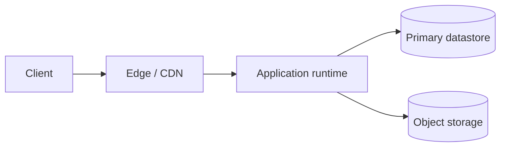

# Deployment Architecture

## Purpose

Describe where and how the system runs: environments, runtime units, network zones and the path a change follows from a commit to production. It must let anyone rebuild an environment without tribal knowledge.

## Guidance

- Describe hosting in generic terms (static hosting, container runtime, managed database, object storage) until the choice is recorded in an ADR.
- Every environment must be reproducible from versioned configuration.
- Secrets never live in the repository; record only where they are stored and who can read them.
- Keep production isolated from non-production data and credentials.

## Environments

| Environment | Purpose | Data | Who deploys | Promotion rule |
|---|---|---|---|---|
| local | Development | Synthetic | Developer | n/a |
| staging | Pre-release validation | {{pending: synthetic or anonymised}} | {{pending: role}} | {{pending: gate to enter}} |
| production | Live users | Real | {{pending: role}} | {{pending: approval required}} |

## Topology

- Hosting model: {{pending: static, server-rendered, containers, serverless or mixed}}
- Regions or locations: {{pending: where the system runs and why}}
- Network zones: {{pending: public, private and data zones}}

## Delivery pipeline

1. Commit and pull request trigger build and tests (`make verify`, `dixi check`).
2. Artifact is built once and promoted unchanged between environments.
3. Deployment to staging: {{pending: automatic or manual}}.
4. Deployment to production: {{pending: approval and rollout strategy}}.
5. Rollback procedure: {{pending: how to return to the previous version}}.

## Configuration and secrets

- Configuration source: {{pending: environment variables, config files, parameter store}}
- Secret storage: {{pending: secret manager or equivalent}}
- Rotation policy: {{pending: frequency and owner}}

## Infrastructure as code

- Tooling: {{pending: tool used to declare infrastructure}}
- Location in repo: {{pending: path}}
- Drift detection: {{pending: how differences are detected}}

## Related

- [System context](system-context.md)
- [Security architecture](security-architecture.md)
- [Architecture decisions](adr/README.md)
- [Test plan](../11-quality/test-plan.md)
- [Guide](../docs/guide.md)
