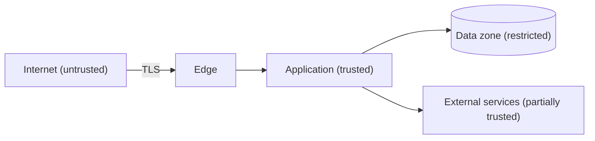

# Security Architecture

## Purpose

Describe how the architecture protects data and functionality: trust boundaries, identity, authorization, data protection and the controls applied at each layer. It records design intent; it is not evidence that a control has been tested or that the system complies with any standard.

## Principles

- Deny by default; grant the least privilege needed.
- Validate every input at the trust boundary where it enters.
- Never trust the client for authorization decisions.
- Keep secrets out of code, logs and prompts.
- Prefer well-known libraries over custom cryptography.

## Trust boundaries

| Boundary | What crosses it | Control |
|---|---|---|
| Internet to edge | User requests | {{pending: TLS, rate limiting, request validation}} |
| Application to data | Queries | {{pending: network isolation, credentials per service}} |
| Application to external | API calls | {{pending: scoped tokens, timeouts, output validation}} |

## Identity and access

- User authentication: {{pending: method, session lifetime, MFA policy}}
- Service-to-service authentication: {{pending: method}}
- Authorization model: {{pending: roles, permissions or attribute-based rules}}
- Administrative access: {{pending: who, how and how it is audited}}

## Data protection

| Data class | Examples | At rest | In transit | Retention |
|---|---|---|---|---|
| Public | Marketing content | n/a | TLS | n/a |
| Internal | Configuration | {{pending: control}} | TLS | {{pending: period}} |
| Personal / sensitive | {{pending: examples}} | {{pending: encryption}} | TLS | {{pending: period}} |

## Logging and monitoring

- Security events recorded: {{pending: logins, permission changes, failures}}
- Personal data in logs: {{pending: masking rule}}
- Alerting: {{pending: what triggers an alert and who receives it}}

## Threats to address

| Threat | Affected component | Mitigation | Status |
|---|---|---|---|
| {{pending: threat}} | {{pending: component}} | {{pending: mitigation}} | Proposed |

## Related

- [System context](system-context.md)
- [Deployment architecture](deployment-architecture.md)
- [Architecture decisions](adr/README.md)
- [Agent instructions](../AGENTS.md)
- [Test plan](../11-quality/test-plan.md)
