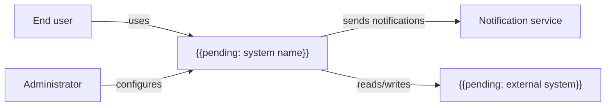

# System Context

## Purpose

Show the system as a single box surrounded by the people and external systems that interact with it. This is the highest-level view: it fixes the scope of the project and the boundaries every other architecture document refines.

## How to use this document

- Keep the system as one box; internal structure belongs in deeper views.
- Name every actor and external system with a neutral, role-based name.
- For each relationship, state direction, purpose and data exchanged.
- Update it whenever a new actor or integration appears. Run `/dixi.architecture` (Claude Code) or `$dixi-architecture` (Codex) to review consistency, and `dixi check` before closing the change.

## Diagram

## Actors

| Actor | Description | Main goals | Channel |
|---|---|---|---|
| End user | {{pending: who they are}} | {{pending: what they need}} | {{pending: web, mobile, API}} |
| Administrator | {{pending: who they are}} | {{pending: what they manage}} | {{pending: channel}} |

## External systems

| System | Owner | Direction | Data exchanged | Criticality |
|---|---|---|---|---|
| {{pending: external system}} | {{pending: internal team or third party}} | {{pending: in/out/both}} | {{pending: data}} | {{pending: high/medium/low}} |

## Scope

- In scope: {{pending: capabilities the system owns}}
- Out of scope: {{pending: capabilities delegated to other systems}}
- Assumptions: {{pending: assumptions about actors or neighbours}}

## Open questions

- {{pending: unresolved boundary or ownership question}}

## Related

- [Vision](../01-business/vision.md)
- [Master spec](../00-master-spec.md)
- [Deployment architecture](deployment-architecture.md)
- [Security architecture](security-architecture.md)
- [Architecture decisions](adr/README.md)
- [Example contract](../07-contracts/example.md)
