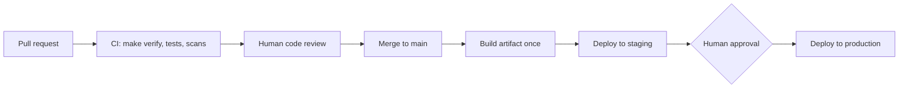

# CI/CD Overview

## Purpose

Describe the path every change follows from a commit to production: which checks run, where humans approve and what is never automated. This area documents delivery; it does not contain infrastructure, provider configuration or account files.

## Principles

- One build per commit; the same artifact is promoted between environments, never rebuilt.
- `make verify` is the mandatory gate: if it fails, nothing moves forward.
- A person approves every promotion to production. No automatic deployment to production without review.
- The pipeline definition is versioned in the repository and reviewed like code.
- Pipelines never print secrets; they read them at run time from the store chosen in the secret management document.

## Flow

## Stages and gates

| Stage | Trigger | Gate to pass | Who decides |
|---|---|---|---|
| Continuous integration | Pull request opened or updated | `make verify` and `dixi check` green, tests pass | Automatic |
| Code review | CI green | {{pending: number of approving reviewers}} | Reviewer |
| Build | Merge to main | Artifact built and tagged with the commit identifier | Automatic |
| Staging | Build succeeded | Smoke checks pass | {{pending: automatic or manual}} |
| Production | Staging verified | Explicit approval recorded | {{pending: role}} |

## Decisions

- CI service: {{pending: decide and record in an ADR}}
- Branch model: {{pending: trunk-based or other}}
- Artifact type and registry: {{pending: decide}}
- Release cadence: {{pending: on demand, daily, weekly}}

## What agents may and may not do

Agents may prepare changes, run `make verify` and draft release notes (for example with `/dixi.release`). They never approve, merge or deploy on behalf of a person.

## Related

- [Environments](environments.md)
- [Deployment strategy](deployment-strategy.md)
- [Rollback strategy](rollback-strategy.md)
- [Deployment architecture](../09-architecture/deployment-architecture.md)
- [Verification ladder](../11-quality/verification-ladder.md)
- [Secret management](../13-security/secret-management.md)
