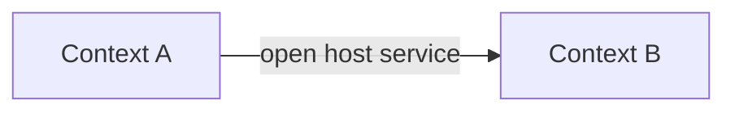

# Bounded context map

## Purpose

Describe the bounded contexts of the platform and the relationships between them. A bounded
context is the boundary inside which a model and its language are consistent. When several
products or teams share a platform, this map makes explicit who adapts to whom, where translation
happens and which contracts protect each model from changes in the others.

## Contexts

| Context | Domains included | Owning team or role | Model it protects |
|---|---|---|---|
| {{pending: context name}} | {{pending: DOMAIN IDs}} | {{pending: owner}} | {{pending: key concepts}} |
| {{pending: context name}} | {{pending: DOMAIN IDs}} | {{pending: owner}} | {{pending: key concepts}} |

## Relationship patterns

Use common integration patterns to describe each relationship:

| Pattern | Meaning |
|---|---|
| Customer / supplier | The downstream context's needs shape the upstream plan. |
| Conformist | The downstream context adopts the upstream model as is. |
| Anti-corruption layer | The downstream context translates the upstream model to protect its own. |
| Open host service | The upstream context publishes a stable, documented protocol. |
| Published language | Contexts exchange a shared, versioned format (schemas, events). |
| Shared kernel | Two contexts share a small model and change it together. |
| Separate ways | No integration; duplication is accepted. |

## Relationships

| Upstream | Downstream | Pattern | Contract | Notes |
|---|---|---|---|---|
| {{pending: context}} | {{pending: context}} | {{pending: pattern}} | {{pending: path in 07-contracts}} | {{pending: translation or risk}} |

## Rules

- Every cross-context call goes through a contract in `07-contracts/`.
- A shared kernel needs an explicit owner and joint review for every change.
- Changes to an open host service follow the versioning policy of its contract.

## Open decisions

- {{pending: relationships whose pattern is still undecided}}

## Related

- [Domain map](domain-map.md)
- [Ubiquitous language](ubiquitous-language.md)
- [Product map](../../02-platform/product-map.md)
- [Event contracts](../../07-contracts/events/README.md)
