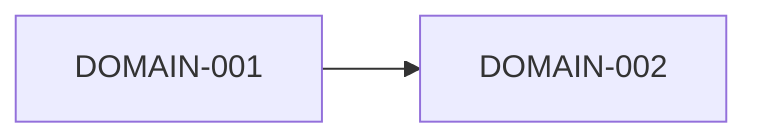

# Domain map

## Purpose

Show the domains of the product, their responsibilities and how they depend on each other. The map
is the bridge between business capabilities and the specs in `03-domains/`: every domain listed
here should have a domain spec with a `DOMAIN-NNN` ID registered in `.dixi/traceability.json`.

## How to draw the map

- Derive domains from groups of related capabilities and from the language people use.
- Give each domain one clear responsibility; if the description needs "and", consider splitting.
- Classify each domain as core, supporting or generic.
- Draw dependencies in one direction where possible; cycles are a design smell.
- Use `/dixi.domain` (or `$dixi-domain`) to draft a domain spec, then validate it with a person.

## Domains

| ID | Domain | Responsibility | Type | Capabilities | Spec |
|---|---|---|---|---|---|
| DOMAIN-001 | {{pending: domain name}} | {{pending: responsibility}} | {{pending: type}} | {{pending: CAP IDs}} | [example](../../03-domains/example/domain-spec.md) |
| DOMAIN-002 | {{pending: domain name}} | {{pending: responsibility}} | {{pending: type}} | {{pending: CAP IDs}} | {{pending: path}} |

## Dependencies

| From | To | Why | Kind of dependency |
|---|---|---|---|
| {{pending: domain}} | {{pending: domain}} | {{pending: reason}} | {{pending: data, command or event}} |

## Data ownership

Each important entity has exactly one owning domain; others read copies or ask through contracts.

| Entity | Owning domain | Consumers |
|---|---|---|
| {{pending: entity}} | {{pending: domain}} | {{pending: domains}} |

## Open decisions

- {{pending: boundaries still under discussion}}

## Related

- [Business capabilities](business-capabilities.md)
- [Ubiquitous language](ubiquitous-language.md)
- [Domain template](../../10-engineering/templates/domain-template.md)
- [Domain example](../../03-domains/example/domain-spec.md)
