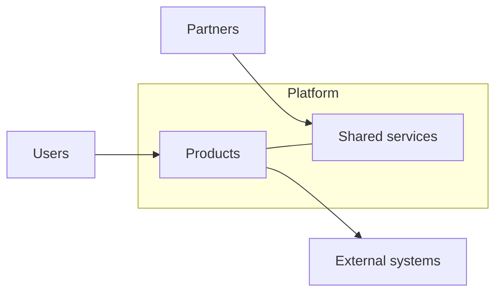

# Ecosystem landscape

## Purpose

Place the platform in its environment: the users, partners, external systems, channels and
regulators around it. The landscape shows what the platform controls, what it depends on and what
it only influences, which is essential to assess risk and to plan integrations.

## Actors around the platform

| Actor | Type | Relationship | Channel | Criticality |
|---|---|---|---|---|
| {{pending: actor}} | {{pending: user, partner, external system or authority}} | {{pending: what they give or receive}} | {{pending: web, mobile, API, file}} | {{pending: high, medium or low}} |
| {{pending: actor}} | {{pending: type}} | {{pending: relationship}} | {{pending: channel}} | {{pending: criticality}} |

Use generic labels ("payment processor", "identity provider") until a supplier is chosen in an ADR.

## Zones of control

| Zone | Contents | How we manage it |
|---|---|---|
| Control | Products, shared services, our data | Specs, tests, reviews |
| Influence | Partners, integrators, community | Contracts, SLAs, documentation |
| Context | Market, regulation, technology trends | Monitoring and periodic review |

## Landscape diagram

## Dependencies and risks

| External dependency | Used by | Risk if unavailable | Mitigation |
|---|---|---|---|
| {{pending: dependency}} | {{pending: products}} | {{pending: impact}} | {{pending: fallback or exit plan}} |

## Market context

- Alternatives users have today: {{pending: categories of alternatives}}
- Trends that may change the landscape: {{pending: trends}}

## Related

- [Platform overview](platform-overview.md)
- [External partners](../01-business/actors/external-partners.md)
- [Integration architecture](../09-architecture/integration-architecture.md)
