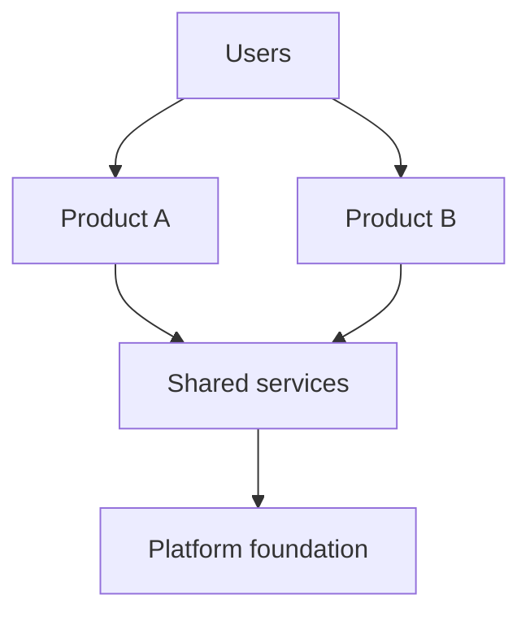

# Platform overview

## Purpose

Give a one-page view of the platform: the products it hosts, the shared services they rely on, who
operates it and the principles that keep it coherent. New contributors and agents should read this
page first to understand where a change fits before opening any product or domain spec.

## Scope

- What the platform is: {{pending: one-sentence description}}
- What it is not: {{pending: responsibilities left to each product or to external systems}}
- Products hosted: see the [product map](product-map.md).
- Platform owner: {{pending: role accountable for platform decisions}}

## Layers

| Layer | Responsibility | Examples of components |
|---|---|---|
| Products | User-facing value for a segment | {{pending: product names}} |
| Shared services | Capabilities reused by several products | {{pending: e.g. identity, notifications, billing}} |
| Platform foundation | Runtime, data, observability, delivery | {{pending: generic components, no vendor names}} |

## Principles

- Products own their domains and data; shared services own only cross-cutting concerns.
- Products integrate through published contracts, never through each other's databases.
- A shared service is added only when at least two products need it and an owner accepts it.
- Tenancy, identity and audit behave the same way in every product.
- {{pending: additional platform principle}}

## Context diagram

## Key decisions

| Topic | Decision | Record |
|---|---|---|
| Tenancy model | {{pending: decision}} | [Tenant strategy](tenant-strategy.md) |
| Identity and access | {{pending: decision}} | [Identity and access strategy](identity-and-access-strategy.md) |
| Hosting and runtime | {{pending: decision}} | {{pending: ADR link}} |

## Related

- [Product map](product-map.md)
- [Shared services map](shared-services-map.md)
- [Ecosystem landscape](ecosystem-landscape.md)
- [System context](../09-architecture/system-context.md)
- [Project](../00-master-spec.md)
