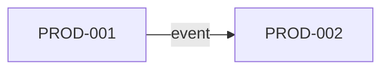

# Product map

## Purpose

List the products on the platform, the segment each one serves, its lifecycle stage and its main
dependencies. The map helps decide where a new capability belongs, spot overlaps between products
and plan which shared services are worth building.

## Products

| ID | Product | Segment | Value delivered | Stage | Owner | Folder |
|---|---|---|---|---|---|---|
| PROD-001 | {{pending: product name}} | {{pending: segment}} | {{pending: value}} | {{pending: idea, pilot, live or retiring}} | {{pending: role}} | {{pending: products/<slug>/}} |
| PROD-002 | {{pending: product name}} | {{pending: segment}} | {{pending: value}} | {{pending: stage}} | {{pending: role}} | {{pending: products/<slug>/}} |

Each product gets its own folder under `products/`; see [products](products/README.md).

## Capability coverage

Mark which product owns each business capability. One owner per capability avoids duplicated logic.

| Capability | PROD-001 | PROD-002 | Shared service |
|---|---|---|---|
| {{pending: CAP ID}} | {{pending: owns, uses or none}} | {{pending: owns, uses or none}} | {{pending: service or none}} |

## Dependencies between products

| From | To | What is exchanged | Contract |
|---|---|---|---|
| {{pending: product}} | {{pending: product}} | {{pending: data, command or event}} | {{pending: path in 07-contracts}} |

Details live in [cross-product integrations](cross-product-integrations.md).

## Overlaps and gaps

- Overlaps to resolve: {{pending: capabilities implemented twice}}
- Gaps no product covers: {{pending: capabilities without an owner}}

## Roadmap view

| Product | Next milestone | Target date |
|---|---|---|
| {{pending: product}} | {{pending: milestone}} | {{pending: date}} |

## Related

- [Platform overview](platform-overview.md)
- [Business capabilities](../01-business/domains/business-capabilities.md)
- [Bounded context map](../01-business/domains/bounded-context-map.md)
- [Product template](../10-engineering/templates/product-template.md)
