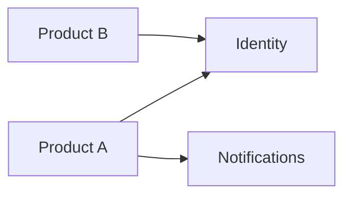

# Shared services map

## Purpose

Describe the services that several products reuse, such as identity, notifications, files, billing
or audit. For each one, record its owner, consumers, contract and service level, so that products
can depend on it with confidence and changes are coordinated instead of surprising.

## When a capability becomes a shared service

- At least two products need it with compatible semantics.
- It is not core differentiation of a single product.
- A named owner accepts to maintain it, version its contract and support consumers.
- The cost of coupling is lower than the cost of duplication.

## Service catalog

| Service | Responsibility | Owner | Consumers | Contract | Service level |
|---|---|---|---|---|---|
| {{pending: e.g. identity}} | {{pending: responsibility}} | {{pending: role}} | {{pending: products}} | {{pending: path in 07-contracts}} | {{pending: availability and latency target}} |
| {{pending: e.g. notifications}} | {{pending: responsibility}} | {{pending: role}} | {{pending: products}} | {{pending: contract}} | {{pending: target}} |
| {{pending: e.g. audit log}} | {{pending: responsibility}} | {{pending: role}} | {{pending: products}} | {{pending: contract}} | {{pending: target}} |

## Consumption rules

- Consumers use only the published contract; no direct access to the service's storage.
- Breaking changes require a new contract version and a deprecation period of {{pending: duration}}.
- Each consumer declares its expected volume so the owner can plan capacity.
- Tenant context and identity are propagated on every call.

## Dependency diagram

## Candidates under evaluation

| Candidate | Products that need it | Decision | Record |
|---|---|---|---|
| {{pending: capability}} | {{pending: products}} | {{pending: share, duplicate or buy}} | {{pending: ADR link}} |

## Related

- [Platform overview](platform-overview.md)
- [Cross-product integrations](cross-product-integrations.md)
- [Identity and access strategy](identity-and-access-strategy.md)
- [API contracts](../07-contracts/api/README.md)
