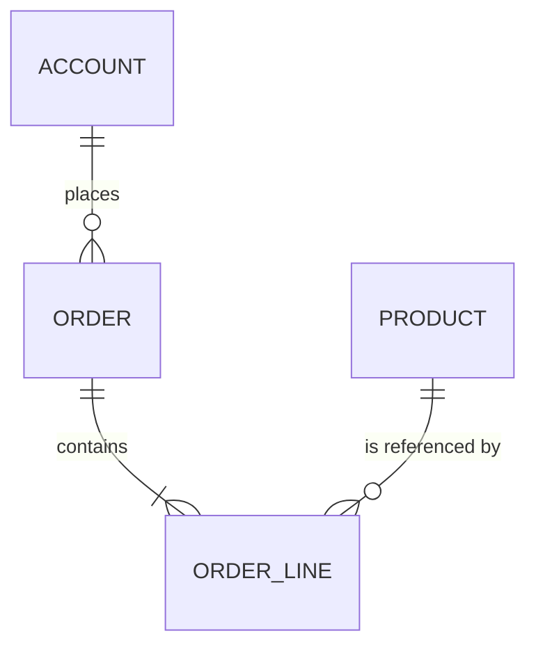

# ERD Overview

## Purpose

Give a high-level entity-relationship view of the system: the main entities, how they relate and which module owns each one. Detailed attributes live in the canonical model; this document focuses on structure and cardinality.

- Diagram source: {{pending: where the diagram source is kept and which notation is used}}

## Diagram

Keep the diagram as text so it can be reviewed in pull requests. Example in Mermaid syntax:

Replace the example with the project's entities: {{pending: main entities and relationships}}

## Entities by module

| Module | Entities owned | Entities referenced (read only) |
| --- | --- | --- |
| | | |

## Relationships

| From | To | Cardinality | Mandatory | On delete | Notes |
| --- | --- | --- | --- | --- | --- |
| | | 1:N | | {{pending: restrict, cascade or soft delete}} | |

## Modelling checklist

- [ ] Every relationship crossing a module boundary is a reference by identifier, not a shared table.
- [ ] Many-to-many relationships have an explicit association entity when they carry attributes.
- [ ] Every entity includes the fields in the [audit fields standard](../audit-fields-standard.md).
- [ ] Entities with personal data are marked and appear in the [PII classification](../pii-classification.md).
- [ ] Names match the [canonical data model](../canonical-data-model.md).
- [ ] Tenant ownership is visible for multi-tenant entities.
- [ ] Indexes support the main access paths listed in the module specs.

## Open questions

| Question | Impact | Owner | Due |
| --- | --- | --- | --- |
| | | | |

## Related

- [Canonical data model](../canonical-data-model.md)
- [Data architecture](../data-architecture.md)
- [Audit fields standard](../audit-fields-standard.md)
- [PII classification](../pii-classification.md)
- [Domain spec example](../../03-domains/example/domain-spec.md)
