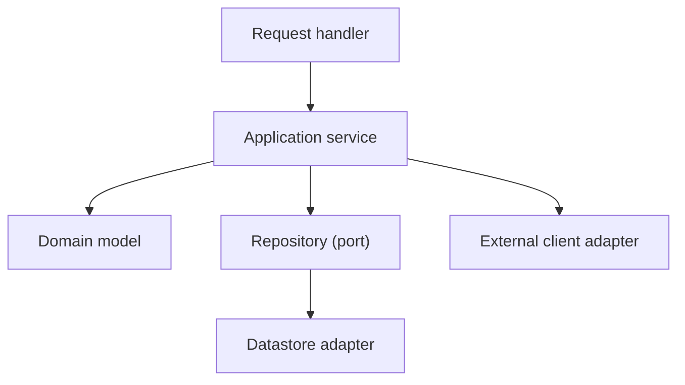

# Component Diagram

## Purpose

Zoom into one container from the [container diagram](container-diagram.md) and show its main components: the modules, services and adapters inside it, their responsibilities and dependencies. It connects the architecture to the module specs in `04-modules/`.

## Guidance

- Draw one diagram per container that has meaningful internal structure.
- Each component should map to a module spec or a clearly named package.
- Dependencies point inwards: domain logic does not depend on frameworks, transport or storage.
- Adapters (HTTP handlers, repositories, clients for external systems) sit at the edges.
- Avoid cycles; if two components depend on each other, extract a contract.

## Diagram: {{pending: container name}}

## Components

| Component | Responsibility | Module spec | Depends on |
|---|---|---|---|
| Request handler | Parse input, call service, map errors | {{pending: link}} | Application service |
| Application service | Orchestrate use cases and transactions | {{pending: link}} | Domain model, ports |
| Domain model | Business rules and invariants | [Example module](../04-modules/example/module-spec.md) | Nothing external |
| Datastore adapter | Persist and load aggregates | {{pending: link}} | Repository port |

## Rules to enforce

- {{pending: dependency rule checked automatically, if any}}
- {{pending: where cross-cutting concerns (logging, auth) are applied}}

## Testing approach

- Domain model: unit tests without infrastructure.
- Adapters: integration tests against real or containerised dependencies.
- Details belong in the [test plan](../11-quality/test-plan.md).

## Related

- [Container diagram](container-diagram.md)
- [Example module spec](../04-modules/example/module-spec.md)
- [Example domain spec](../03-domains/example/domain-spec.md)
- [Architecture decisions](adr/README.md)
- [Test plan](../11-quality/test-plan.md)
