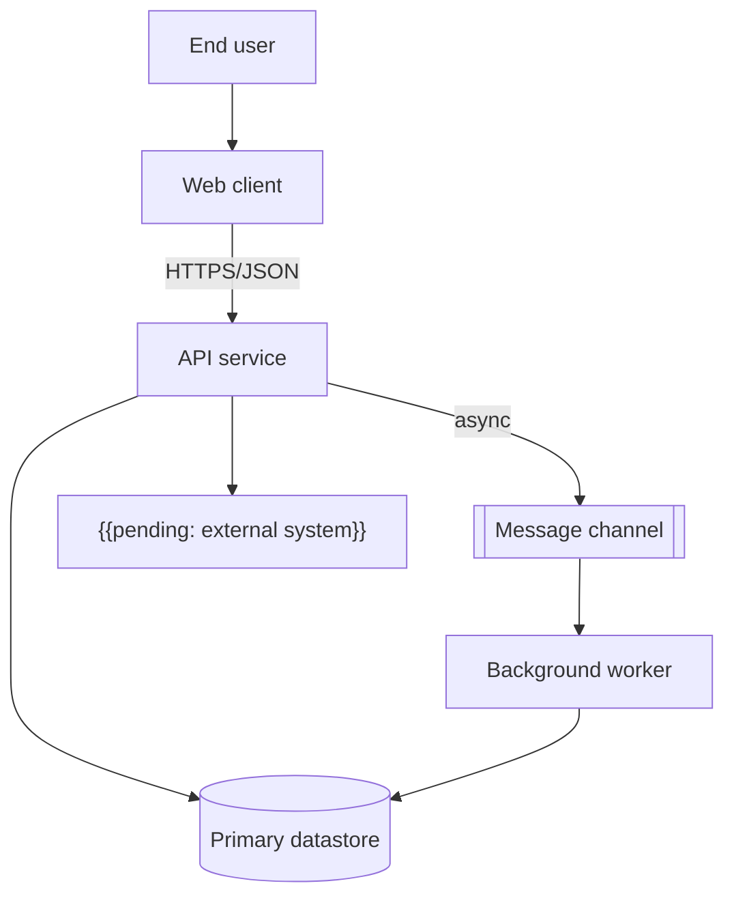

# Container Diagram

## Purpose

Zoom into the system box from the [system context](system-context.md) and show its deployable or runnable units (containers in the architectural sense: web app, API, worker, database, queue) and how they communicate. It is the reference for ownership, technology choices and protocols between units.

## Guidance

- One box per independently deployable or runnable unit.
- Label every arrow with purpose and protocol (for example "reads orders, HTTPS/JSON").
- Datastores are containers too; show which unit owns each one.
- A unit should not read another unit's datastore directly; go through its contract.
- Record technology choices only after the matching ADR is Accepted.

## Diagram

## Containers

| Container | Responsibility | Technology | Owns data | Owner |
|---|---|---|---|---|
| Web client | User interface | {{pending: technology}} | No | {{pending: team}} |
| API service | Business operations and contracts | {{pending: technology}} | {{pending: yes/no}} | {{pending: team}} |
| Background worker | Asynchronous jobs | {{pending: technology}} | No | {{pending: team}} |
| Primary datastore | Persistent state | {{pending: technology}} | Yes | {{pending: team}} |

## Communication

| From | To | Style | Protocol | Contract |
|---|---|---|---|---|
| Web client | API service | Synchronous | {{pending: protocol}} | {{pending: link to contract}} |
| API service | Background worker | Asynchronous | {{pending: protocol}} | {{pending: message schema}} |

## Open decisions

- {{pending: whether the worker is needed from day one}}
- {{pending: single datastore or one per container}}

## Related

- [System context](system-context.md)
- [Component diagram](component-diagram.md)
- [Deployment architecture](deployment-architecture.md)
- [Integration architecture](integration-architecture.md)
- [Example contract](../07-contracts/example.md)
- [Architecture decisions](adr/README.md)
