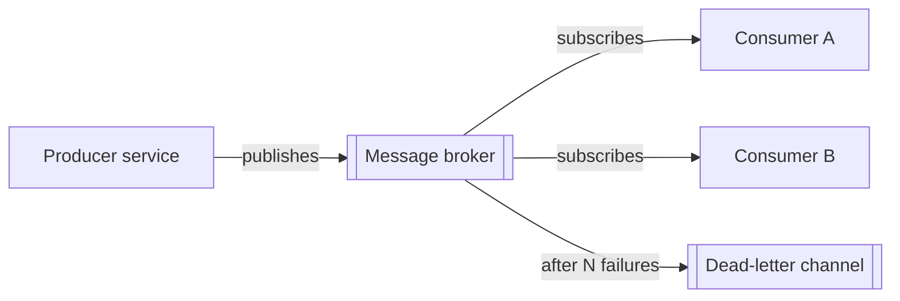

# Event Architecture

## Purpose

Describe how containers and services communicate through events and messages: which events exist, who publishes and consumes them, delivery guarantees and how failures are handled. It is the map of asynchronous flows in the platform.

## Guidance

- Name events in the past tense after a business fact (`order.placed`, not `create_order`).
- One owner publishes each event type; many consumers may subscribe.
- Consumers must be idempotent: assume at-least-once delivery unless stated otherwise.
- Events carry a schema version, a unique ID, a timestamp and a correlation ID.
- Do not put secrets or unnecessary personal data in event payloads.
- Use the outbox pattern (or equivalent) when a state change and its event must not diverge.

## Flow

## Event catalogue

| Event | Producer | Consumers | Schema | Ordering needed |
|---|---|---|---|---|
| {{pending: domain.fact}} | {{pending: service}} | {{pending: services}} | {{pending: link to contract}} | {{pending: yes/no, key}} |

## Delivery guarantees

- Broker type: {{pending: queue, log-based stream or pub/sub}}
- Guarantee: {{pending: at-least-once or exactly-once processing strategy}}
- Ordering: {{pending: per key, per partition or none}}
- Retention: {{pending: how long messages are kept}}

## Failure handling

| Situation | Behaviour |
|---|---|
| Consumer error | Retry with backoff up to {{pending: N}} attempts |
| Poison message | Move to dead-letter channel and alert |
| Schema mismatch | {{pending: reject or tolerate unknown fields}} |
| Replay | {{pending: how to reprocess from a point in time}} |

## Observability

- Metrics: queue depth, consumer lag, processing time, dead-letter count.
- Tracing: propagate the correlation ID across producer and consumers.

## Related

- [Integration architecture](integration-architecture.md)
- [Container diagram](container-diagram.md)
- [Resilience architecture](resilience-architecture.md)
- [Example contract](../07-contracts/example.md)
- [Architecture decisions](adr/README.md)
