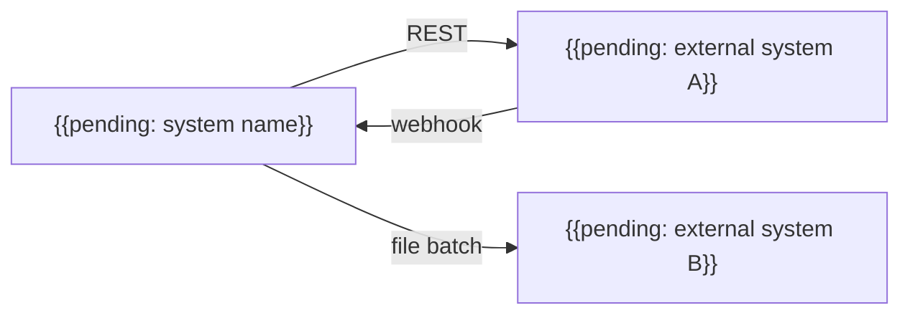

# Integration Architecture

## Purpose

Describe how the system exchanges data with external systems and between its own containers: styles, contracts, error handling and ownership. Every integration listed here must have a contract in `07-contracts/`.

## Guidance

- Prefer one integration style per use: synchronous request/response for queries that need an immediate answer, asynchronous messages for work that can happen later.
- Isolate each external system behind an adapter so it can be replaced or simulated in tests.
- Treat data received from outside as untrusted: validate schema, size and content.
- Every call needs a timeout; every retry needs a limit and idempotency.
- Version contracts and keep backward compatibility during migrations.

## Integration map

## Integrations

| Integration | Direction | Style | Contract | Frequency | Owner |
|---|---|---|---|---|---|
| {{pending: external system A}} | out/in | {{pending: REST, webhook}} | [Example](../07-contracts/example.md) | {{pending: on demand}} | {{pending: team}} |
| {{pending: external system B}} | out | {{pending: batch file}} | {{pending: link}} | {{pending: daily}} | {{pending: team}} |

## Error handling

| Situation | Behaviour |
|---|---|
| Timeout | {{pending: retry policy and limit}} |
| Invalid response | {{pending: reject, log and alert}} |
| External system unavailable | {{pending: queue, degrade or fail fast}} |
| Duplicate delivery | Handle idempotently using {{pending: idempotency key}} |

## Authentication with partners

- Outbound credentials: {{pending: how they are issued and stored}}
- Inbound verification: {{pending: signature, token or mutual TLS}}

## Versioning

- Strategy: {{pending: URL, header or schema version}}
- Deprecation window: {{pending: duration}}

## Related

- [Container diagram](container-diagram.md)
- [Resilience architecture](resilience-architecture.md)
- [Security architecture](security-architecture.md)
- [Example contract](../07-contracts/example.md)
- [Architecture decisions](adr/README.md)
