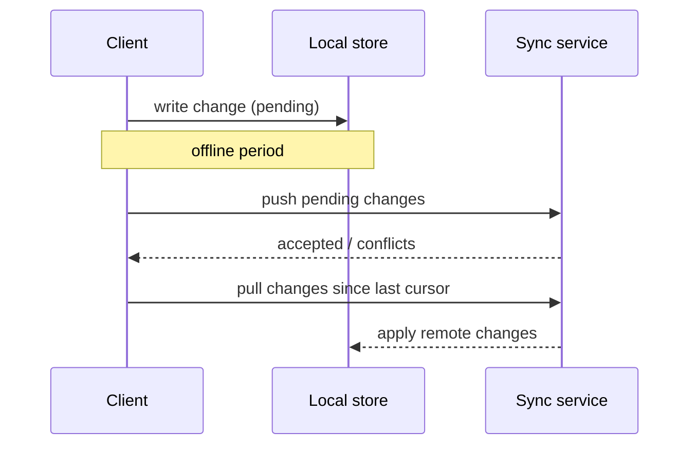

# Offline Sync Architecture

## Purpose

Describe how clients keep working without connectivity and how local changes are synchronised with the server once the connection returns: local storage, change tracking, conflict resolution and security of data at rest on devices.

## Scope

- Clients that work offline: {{pending: mobile app, desktop app, web app with service worker}}
- Features available offline: {{pending: read-only, create, edit, delete}}
- Features that require connectivity: {{pending: list}}

## Flow

## Data model for sync

- Change tracking: {{pending: per-record version, timestamps or operation log}}
- Identifiers: generated on the client so records can be created offline (for example UUIDs).
- Sync cursor: {{pending: how the client knows what it has already received}}
- Deletions: propagated as tombstones, purged after {{pending: period}}.

## Conflict resolution

| Case | Rule |
|---|---|
| Same field edited on two devices | {{pending: last-writer-wins, merge or ask the user}} |
| Edit on a record deleted elsewhere | {{pending: rule}} |
| Business invariant broken after merge | Server rejects and the client shows the conflict |

The server remains the source of truth and revalidates every pushed change.

## Limits

- Maximum offline period supported: {{pending: duration}}
- Local storage quota: {{pending: size and eviction policy}}
- Batch size per sync: {{pending: records or bytes}}

## Security on the device

- Local data encryption: {{pending: approach}}
- What happens on logout or device loss: {{pending: wipe policy}}
- Tokens offline: {{pending: expiry and refresh behaviour}}

## Related

- [Container diagram](container-diagram.md)
- [Integration architecture](integration-architecture.md)
- [Security architecture](security-architecture.md)
- [Resilience architecture](resilience-architecture.md)
- [Architecture decisions](adr/README.md)
