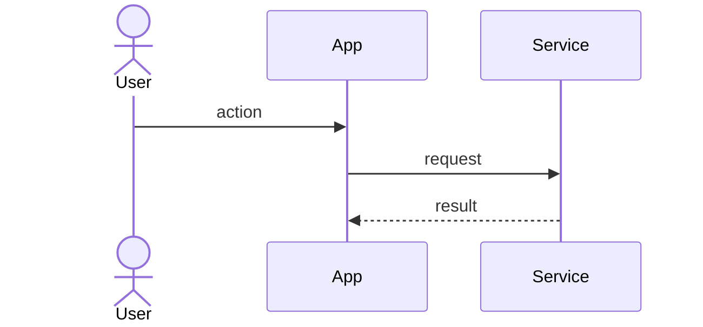

# Flow template

## Purpose

Describe a process that crosses steps, actors or modules: the happy path, alternatives, errors and
the events it emits. Copy the structure below for each relevant business flow.

## Template

````markdown
# Flow: <flow name>

ID: {{pending: flow ID}}
Related features: FEATURE-NNN
Owner: {{pending: person responsible}}

## Description

What the flow achieves and who starts it.

## Preconditions

- ...

## Main flow (happy path)

1. Actor does ...
2. System validates ...
3. System records ... and emits `<event>`.

## Diagram



## Alternative flows

- AF-1 <name>: at step N, if ..., then ...

## Error handling

| Step | Error | Behavior | Error code |
|---|---|---|---|

## Events emitted

| Event | Step | Consumers |
|---|---|---|

## Integrations

| External system | Step | Timeout and retry policy |
|---|---|---|

## Postconditions

- ...
````

## Notes

- Each alternative and error row becomes at least one test.
- Diagram format: {{pending: diagram notation used by the project}}

## Related

- [Domain template](domain-template.md)
- [Module template](module-template.md)
- [Error handling standard](../error-handling-standard.md)
