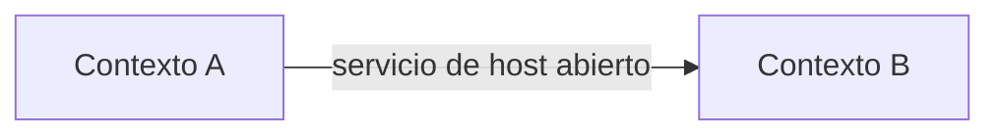

# Mapa de contextos delimitados

## Propósito

Describir los contextos delimitados de la plataforma y las relaciones entre ellos. Un contexto
delimitado es la frontera dentro de la cual un modelo y su lenguaje son coherentes. Cuando varios
productos o equipos comparten una plataforma, este mapa hace explícito quién se adapta a quién,
dónde se traduce y qué contratos protegen cada modelo de los cambios de los demás.

## Contextos

| Contexto | Dominios incluidos | Equipo o rol propietario | Modelo que protege |
|---|---|---|---|
| {{pending: nombre del contexto}} | {{pending: IDs de DOMAIN}} | {{pending: propietario}} | {{pending: conceptos clave}} |
| {{pending: nombre del contexto}} | {{pending: IDs de DOMAIN}} | {{pending: propietario}} | {{pending: conceptos clave}} |

## Patrones de relación

Usa patrones de integración habituales para describir cada relación:

| Patrón | Significado |
|---|---|
| Cliente / proveedor | Las necesidades del contexto consumidor condicionan el plan del proveedor. |
| Conformista | El contexto consumidor adopta el modelo del proveedor tal cual. |
| Capa anticorrupción | El consumidor traduce el modelo del proveedor para proteger el suyo. |
| Servicio de host abierto | El proveedor publica un protocolo estable y documentado. |
| Lenguaje publicado | Los contextos intercambian un formato compartido y versionado (esquemas, eventos). |
| Núcleo compartido | Dos contextos comparten un modelo pequeño y lo cambian juntos. |
| Caminos separados | Sin integración; se acepta la duplicación. |

## Relaciones

| Proveedor | Consumidor | Patrón | Contrato | Notas |
|---|---|---|---|---|
| {{pending: contexto}} | {{pending: contexto}} | {{pending: patrón}} | {{pending: ruta en 07-contracts}} | {{pending: traducción o riesgo}} |

## Reglas

- Toda llamada entre contextos pasa por un contrato de `07-contracts/`.
- Un núcleo compartido necesita un propietario explícito y revisión conjunta de cada cambio.
- Los cambios en un servicio de host abierto siguen la política de versionado de su contrato.

## Decisiones abiertas

- {{pending: relaciones cuyo patrón aún no está decidido}}

## Relacionados

- [Mapa de dominios](domain-map.md)
- [Lenguaje ubicuo](ubiquitous-language.md)
- [Mapa de productos](../../02-platform/product-map.md)
- [Contratos de eventos](../../07-contracts/events/README.md)
