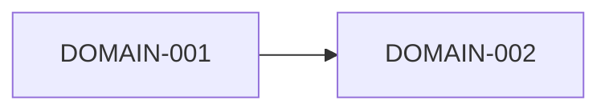

# Mapa de dominios

## Propósito

Mostrar los dominios del producto, sus responsabilidades y cómo dependen entre sí. El mapa es el
puente entre las capacidades de negocio y las especificaciones de `03-domains/`: cada dominio listado
aquí debería tener una especificación con un ID `DOMAIN-NNN` registrado en `.dixi/traceability.json`.

## Cómo dibujar el mapa

- Deriva los dominios de grupos de capacidades relacionadas y del lenguaje que usa la gente.
- Da a cada dominio una responsabilidad clara; si la descripción necesita «y», plantéate dividirlo.
- Clasifica cada dominio como núcleo, soporte o genérico.
- Dibuja las dependencias en un solo sentido cuando sea posible; los ciclos son señal de mal diseño.
- Usa `/dixi.domain` (o `$dixi-domain`) para redactar una especificación de dominio y valídala con una persona.

## Dominios

| ID | Dominio | Responsabilidad | Tipo | Capacidades | Especificación |
|---|---|---|---|---|---|
| DOMAIN-001 | {{pending: nombre del dominio}} | {{pending: responsabilidad}} | {{pending: tipo}} | {{pending: IDs de CAP}} | [ejemplo](../../03-domains/example/domain-spec.md) |
| DOMAIN-002 | {{pending: nombre del dominio}} | {{pending: responsabilidad}} | {{pending: tipo}} | {{pending: IDs de CAP}} | {{pending: ruta}} |

## Dependencias

| Desde | Hacia | Por qué | Tipo de dependencia |
|---|---|---|---|
| {{pending: dominio}} | {{pending: dominio}} | {{pending: motivo}} | {{pending: datos, comando o evento}} |

## Propiedad de los datos

Cada entidad importante tiene exactamente un dominio propietario; los demás leen copias o piden a
través de contratos.

| Entidad | Dominio propietario | Consumidores |
|---|---|---|
| {{pending: entidad}} | {{pending: dominio}} | {{pending: dominios}} |

## Decisiones abiertas

- {{pending: fronteras que siguen en discusión}}

## Relacionados

- [Capacidades de negocio](business-capabilities.md)
- [Lenguaje ubicuo](ubiquitous-language.md)
- [Plantilla de dominio](../../10-engineering/templates/domain-template.md)
- [Ejemplo de dominio](../../03-domains/example/domain-spec.md)
