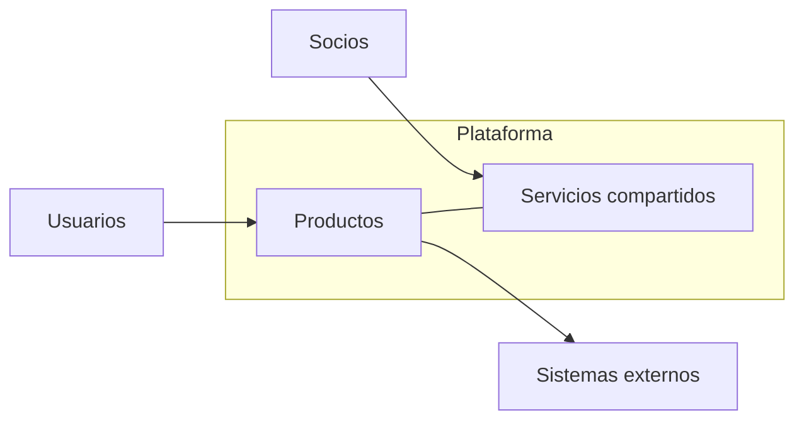

# Panorama del ecosistema

## Propósito

Situar la plataforma en su entorno: usuarios, socios, sistemas externos, canales y autoridades que
la rodean. El panorama muestra qué controla la plataforma, de qué depende y sobre qué solo influye,
algo esencial para evaluar riesgos y planificar integraciones.

## Actores alrededor de la plataforma

| Actor | Tipo | Relación | Canal | Criticidad |
|---|---|---|---|---|
| {{pending: actor}} | {{pending: usuario, socio, sistema externo o autoridad}} | {{pending: qué aporta o recibe}} | {{pending: web, móvil, API, archivo}} | {{pending: alta, media o baja}} |
| {{pending: actor}} | {{pending: tipo}} | {{pending: relación}} | {{pending: canal}} | {{pending: criticidad}} |

Usa etiquetas genéricas («procesador de pagos», «proveedor de identidad») hasta que se elija un
proveedor en un ADR.

## Zonas de control

| Zona | Contenido | Cómo la gestionamos |
|---|---|---|
| Control | Productos, servicios compartidos, nuestros datos | Especificaciones, pruebas, revisiones |
| Influencia | Socios, integradores, comunidad | Contratos, niveles de servicio, documentación |
| Contexto | Mercado, regulación, tendencias tecnológicas | Seguimiento y revisión periódica |

## Diagrama del panorama

## Dependencias y riesgos

| Dependencia externa | Usada por | Riesgo si no está disponible | Mitigación |
|---|---|---|---|
| {{pending: dependencia}} | {{pending: productos}} | {{pending: impacto}} | {{pending: alternativa o plan de salida}} |

## Contexto de mercado

- Alternativas que tienen hoy los usuarios: {{pending: categorías de alternativas}}
- Tendencias que pueden cambiar el panorama: {{pending: tendencias}}

## Relacionados

- [Visión general de la plataforma](platform-overview.md)
- [Socios externos](../01-business/actors/external-partners.md)
- [Arquitectura de integración](../09-architecture/integration-architecture.md)
