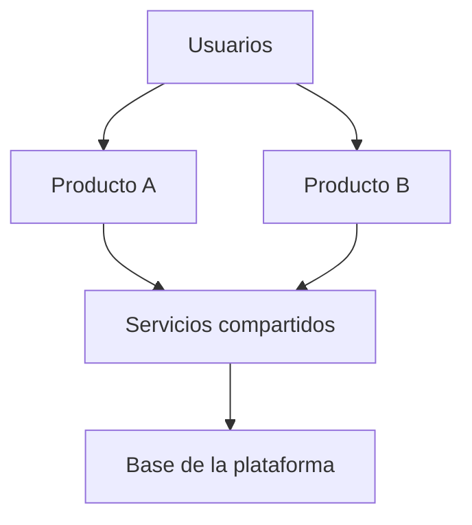

# Visión general de la plataforma

## Propósito

Ofrecer en una página la visión de la plataforma: los productos que aloja, los servicios compartidos
de los que dependen, quién la opera y los principios que la mantienen coherente. Las personas y los
agentes que se incorporan deberían leer esta página primero para entender dónde encaja un cambio
antes de abrir la especificación de un producto o dominio.

## Alcance

- Qué es la plataforma: {{pending: descripción en una frase}}
- Qué no es: {{pending: responsabilidades que quedan en cada producto o en sistemas externos}}
- Productos alojados: consulta el [mapa de productos](product-map.md).
- Responsable de la plataforma: {{pending: rol que rinde cuentas de las decisiones de plataforma}}

## Capas

| Capa | Responsabilidad | Ejemplos de componentes |
|---|---|---|
| Productos | Valor para un segmento de usuarios | {{pending: nombres de productos}} |
| Servicios compartidos | Capacidades que reutilizan varios productos | {{pending: p. ej. identidad, notificaciones, facturación}} |
| Base de la plataforma | Ejecución, datos, observabilidad, entrega | {{pending: componentes genéricos, sin nombres de proveedores}} |

## Principios

- Los productos son dueños de sus dominios y datos; los servicios compartidos solo de lo transversal.
- Los productos se integran mediante contratos publicados, nunca a través de la base de datos de otro.
- Un servicio compartido solo se crea cuando al menos dos productos lo necesitan y alguien acepta ser su responsable.
- Tenencia, identidad y auditoría se comportan igual en todos los productos.
- {{pending: principio adicional de plataforma}}

## Diagrama de contexto

## Decisiones clave

| Tema | Decisión | Registro |
|---|---|---|
| Modelo de tenencia | {{pending: decisión}} | [Estrategia de tenencia](tenant-strategy.md) |
| Identidad y acceso | {{pending: decisión}} | [Estrategia de identidad y acceso](identity-and-access-strategy.md) |
| Alojamiento y ejecución | {{pending: decisión}} | {{pending: enlace al ADR}} |

## Relacionados

- [Mapa de productos](product-map.md)
- [Mapa de servicios compartidos](shared-services-map.md)
- [Panorama del ecosistema](ecosystem-landscape.md)
- [Contexto del sistema](../09-architecture/system-context.md)
- [Proyecto](../00-master-spec.md)
