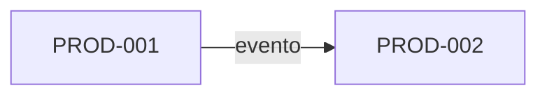

# Mapa de productos

## Propósito

Enumerar los productos de la plataforma, el segmento al que sirve cada uno, su etapa de ciclo de
vida y sus dependencias principales. El mapa ayuda a decidir dónde encaja una capacidad nueva,
detectar solapamientos entre productos y planificar qué servicios compartidos merece la pena crear.

## Productos

| ID | Producto | Segmento | Valor que aporta | Etapa | Responsable | Carpeta |
|---|---|---|---|---|---|---|
| PROD-001 | {{pending: nombre del producto}} | {{pending: segmento}} | {{pending: valor}} | {{pending: idea, piloto, en producción o en retirada}} | {{pending: rol}} | {{pending: products/<slug>/}} |
| PROD-002 | {{pending: nombre del producto}} | {{pending: segmento}} | {{pending: valor}} | {{pending: etapa}} | {{pending: rol}} | {{pending: products/<slug>/}} |

Cada producto tiene su propia carpeta en `products/`; consulta [productos](products/README.md).

## Cobertura de capacidades

Indica qué producto es dueño de cada capacidad de negocio. Un único dueño por capacidad evita lógica
duplicada.

| Capacidad | PROD-001 | PROD-002 | Servicio compartido |
|---|---|---|---|
| {{pending: ID de CAP}} | {{pending: dueño, usa o nada}} | {{pending: dueño, usa o nada}} | {{pending: servicio o ninguno}} |

## Dependencias entre productos

| Desde | Hacia | Qué se intercambia | Contrato |
|---|---|---|---|
| {{pending: producto}} | {{pending: producto}} | {{pending: datos, comando o evento}} | {{pending: ruta en 07-contracts}} |

El detalle está en [integraciones entre productos](cross-product-integrations.md).

## Solapamientos y huecos

- Solapamientos a resolver: {{pending: capacidades implementadas dos veces}}
- Huecos que ningún producto cubre: {{pending: capacidades sin dueño}}

## Vista de hoja de ruta

| Producto | Próximo hito | Fecha objetivo |
|---|---|---|
| {{pending: producto}} | {{pending: hito}} | {{pending: fecha}} |

## Relacionados

- [Visión general de la plataforma](platform-overview.md)
- [Capacidades de negocio](../01-business/domains/business-capabilities.md)
- [Mapa de contextos delimitados](../01-business/domains/bounded-context-map.md)
- [Plantilla de producto](../10-engineering/templates/product-template.md)
