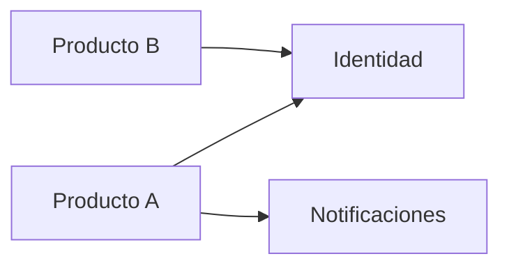

# Mapa de servicios compartidos

## Propósito

Describir los servicios que reutilizan varios productos, como identidad, notificaciones, archivos,
facturación o auditoría. Para cada uno, registra su responsable, consumidores, contrato y nivel de
servicio, de modo que los productos dependan de él con confianza y los cambios se coordinen en
lugar de sorprender.

## Cuándo una capacidad se convierte en servicio compartido

- Al menos dos productos la necesitan con una semántica compatible.
- No es la diferenciación central de un único producto.
- Una persona responsable acepta mantenerla, versionar su contrato y dar soporte a los consumidores.
- El coste del acoplamiento es menor que el de la duplicación.

## Catálogo de servicios

| Servicio | Responsabilidad | Responsable | Consumidores | Contrato | Nivel de servicio |
|---|---|---|---|---|---|
| {{pending: p. ej. identidad}} | {{pending: responsabilidad}} | {{pending: rol}} | {{pending: productos}} | {{pending: ruta en 07-contracts}} | {{pending: objetivo de disponibilidad y latencia}} |
| {{pending: p. ej. notificaciones}} | {{pending: responsabilidad}} | {{pending: rol}} | {{pending: productos}} | {{pending: contrato}} | {{pending: objetivo}} |
| {{pending: p. ej. registro de auditoría}} | {{pending: responsabilidad}} | {{pending: rol}} | {{pending: productos}} | {{pending: contrato}} | {{pending: objetivo}} |

## Reglas de consumo

- Los consumidores usan solo el contrato publicado; sin acceso directo al almacenamiento del servicio.
- Los cambios incompatibles requieren una nueva versión del contrato y un periodo de retirada de
  {{pending: duración}}.
- Cada consumidor declara el volumen esperado para que el responsable planifique la capacidad.
- El contexto de tenencia y la identidad se propagan en cada llamada.

## Diagrama de dependencias

## Candidatos en evaluación

| Candidato | Productos que lo necesitan | Decisión | Registro |
|---|---|---|---|
| {{pending: capacidad}} | {{pending: productos}} | {{pending: compartir, duplicar o comprar}} | {{pending: enlace al ADR}} |

## Relacionados

- [Visión general de la plataforma](platform-overview.md)
- [Integraciones entre productos](cross-product-integrations.md)
- [Estrategia de identidad y acceso](identity-and-access-strategy.md)
- [Contratos de API](../07-contracts/api/README.md)
