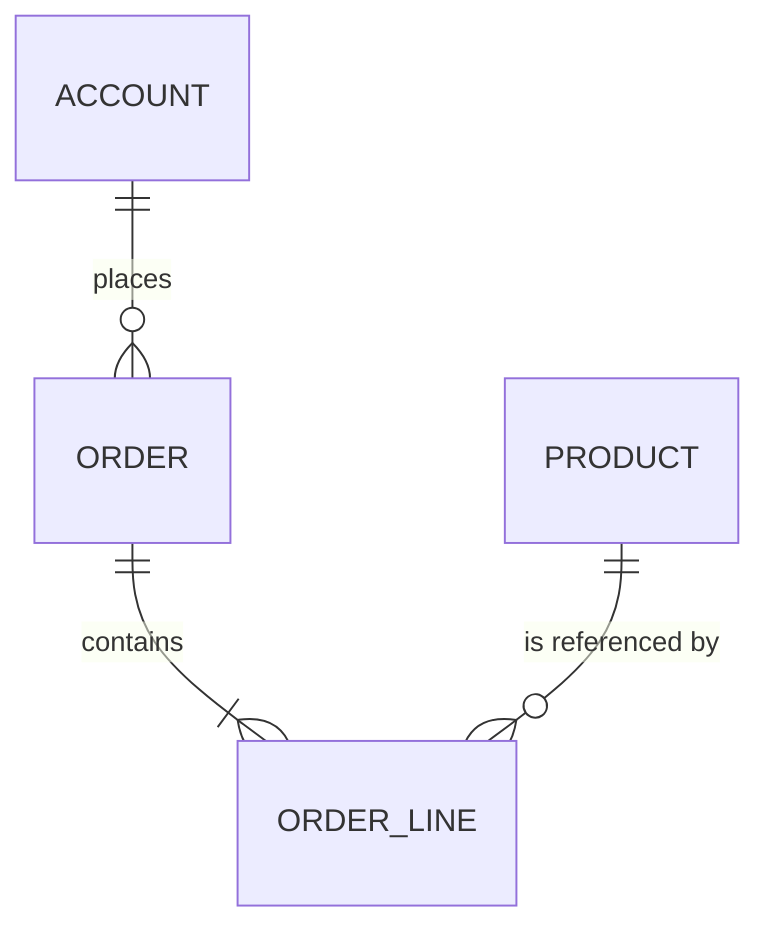

# Vista general del ERD

## Propósito

Ofrecer una vista entidad-relación de alto nivel del sistema: las entidades principales, cómo se relacionan y qué módulo es dueño de cada una. Los atributos detallados viven en el modelo canónico; este documento se centra en la estructura y la cardinalidad.

- Fuente del diagrama: {{pending: dónde se guarda la fuente del diagrama y qué notación se usa}}

## Diagrama

Mantén el diagrama como texto para poder revisarlo en pull requests. Ejemplo en sintaxis Mermaid:

Sustituye el ejemplo por las entidades del proyecto: {{pending: entidades y relaciones principales}}

## Entidades por módulo

| Módulo | Entidades propias | Entidades referenciadas (solo lectura) |
| --- | --- | --- |
| | | |

## Relaciones

| Desde | Hacia | Cardinalidad | Obligatoria | Al borrar | Notas |
| --- | --- | --- | --- | --- | --- |
| | | 1:N | | {{pending: restringir, cascada o borrado lógico}} | |

## Checklist de modelado

- [ ] Toda relación que cruza una frontera de módulo es una referencia por identificador, no una tabla compartida.
- [ ] Las relaciones muchos a muchos tienen una entidad de asociación explícita cuando llevan atributos.
- [ ] Cada entidad incluye los campos del [estándar de campos de auditoría](../audit-fields-standard.md).
- [ ] Las entidades con datos personales están marcadas y figuran en la [clasificación de datos personales](../pii-classification.md).
- [ ] Los nombres coinciden con el [modelo de datos canónico](../canonical-data-model.md).
- [ ] La propiedad por tenant es visible en las entidades multi-tenant.
- [ ] Los índices soportan los caminos de acceso principales descritos en las specs de módulo.

## Preguntas abiertas

| Pregunta | Impacto | Responsable | Fecha |
| --- | --- | --- | --- |
| | | | |

## Relacionados

- [Modelo de datos canónico](../canonical-data-model.md)
- [Arquitectura de datos](../data-architecture.md)
- [Estándar de campos de auditoría](../audit-fields-standard.md)
- [Clasificación de datos personales](../pii-classification.md)
- [Ejemplo de dominio](../../03-domains/example/domain-spec.md)
