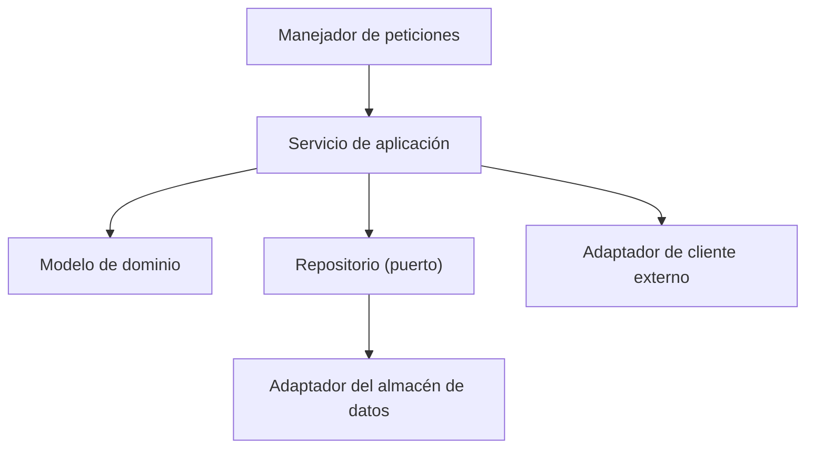

# Diagrama de componentes

## Propósito

Ampliar un contenedor del [diagrama de contenedores](container-diagram.md) y mostrar sus componentes principales: los módulos, servicios y adaptadores que contiene, sus responsabilidades y dependencias. Conecta la arquitectura con las especificaciones de módulo de `04-modules/`.

## Guía

- Dibuja un diagrama por cada contenedor con estructura interna relevante.
- Cada componente debe corresponder a una especificación de módulo o a un paquete con nombre claro.
- Las dependencias apuntan hacia dentro: la lógica de dominio no depende de frameworks, transporte ni almacenamiento.
- Los adaptadores (manejadores HTTP, repositorios, clientes de sistemas externos) se sitúan en los bordes.
- Evita ciclos; si dos componentes dependen entre sí, extrae un contrato.

## Diagrama: {{pending: nombre del contenedor}}

## Componentes

| Componente | Responsabilidad | Especificación de módulo | Depende de |
|---|---|---|---|
| Manejador de peticiones | Interpretar la entrada, llamar al servicio, traducir errores | {{pending: enlace}} | Servicio de aplicación |
| Servicio de aplicación | Orquestar casos de uso y transacciones | {{pending: enlace}} | Modelo de dominio, puertos |
| Modelo de dominio | Reglas de negocio e invariantes | [Módulo de ejemplo](../04-modules/example/module-spec.md) | Nada externo |
| Adaptador del almacén de datos | Guardar y cargar agregados | {{pending: enlace}} | Puerto de repositorio |

## Reglas a hacer cumplir

- {{pending: regla de dependencias verificada automáticamente, si la hay}}
- {{pending: dónde se aplican los aspectos transversales (logs, autenticación)}}

## Enfoque de pruebas

- Modelo de dominio: pruebas unitarias sin infraestructura.
- Adaptadores: pruebas de integración contra dependencias reales o en contenedores.
- Los detalles van en el [plan de pruebas](../11-quality/test-plan.md).

## Relacionados

- [Diagrama de contenedores](container-diagram.md)
- [Especificación del módulo de ejemplo](../04-modules/example/module-spec.md)
- [Especificación del dominio de ejemplo](../03-domains/example/domain-spec.md)
- [Decisiones de arquitectura](adr/README.md)
- [Plan de pruebas](../11-quality/test-plan.md)
