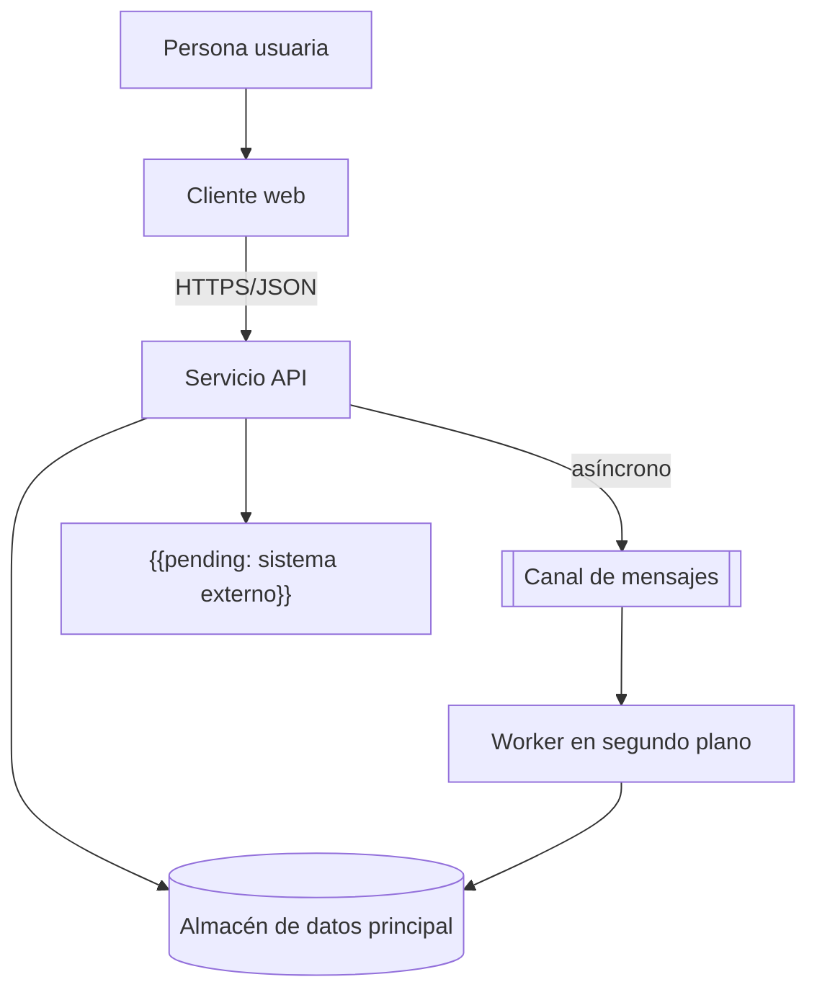

# Diagrama de contenedores

## Propósito

Ampliar la caja del sistema del [contexto del sistema](system-context.md) y mostrar sus unidades desplegables o ejecutables (contenedores en sentido arquitectónico: aplicación web, API, worker, base de datos, cola) y cómo se comunican. Es la referencia para responsables, elecciones tecnológicas y protocolos entre unidades.

## Guía

- Una caja por cada unidad que se despliega o ejecuta de forma independiente.
- Etiqueta cada flecha con propósito y protocolo (por ejemplo «lee pedidos, HTTPS/JSON»).
- Los almacenes de datos también son contenedores; indica qué unidad posee cada uno.
- Una unidad no debe leer directamente el almacén de otra; debe pasar por su contrato.
- Registra las elecciones tecnológicas solo cuando el ADR correspondiente esté en Accepted.

## Diagrama

## Contenedores

| Contenedor | Responsabilidad | Tecnología | Posee datos | Responsable |
|---|---|---|---|---|
| Cliente web | Interfaz de usuario | {{pending: tecnología}} | No | {{pending: equipo}} |
| Servicio API | Operaciones de negocio y contratos | {{pending: tecnología}} | {{pending: sí/no}} | {{pending: equipo}} |
| Worker en segundo plano | Tareas asíncronas | {{pending: tecnología}} | No | {{pending: equipo}} |
| Almacén de datos principal | Estado persistente | {{pending: tecnología}} | Sí | {{pending: equipo}} |

## Comunicación

| Desde | Hacia | Estilo | Protocolo | Contrato |
|---|---|---|---|---|
| Cliente web | Servicio API | Síncrono | {{pending: protocolo}} | {{pending: enlace al contrato}} |
| Servicio API | Worker en segundo plano | Asíncrono | {{pending: protocolo}} | {{pending: esquema del mensaje}} |

## Decisiones abiertas

- {{pending: si el worker hace falta desde el primer día}}
- {{pending: un único almacén de datos o uno por contenedor}}

## Relacionados

- [Contexto del sistema](system-context.md)
- [Diagrama de componentes](component-diagram.md)
- [Arquitectura de despliegue](deployment-architecture.md)
- [Arquitectura de integración](integration-architecture.md)
- [Contrato de ejemplo](../07-contracts/example.md)
- [Decisiones de arquitectura](adr/README.md)
