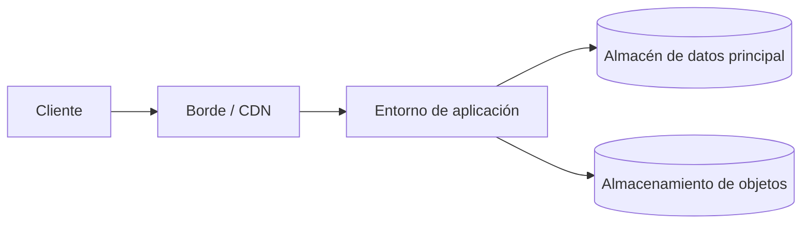

# Arquitectura de despliegue

## Propósito

Describir dónde y cómo se ejecuta el sistema: entornos, unidades de ejecución, zonas de red y el camino que sigue un cambio desde un commit hasta producción. Debe permitir que cualquiera reconstruya un entorno sin depender de conocimiento no escrito.

## Guía

- Describe el alojamiento en términos genéricos (alojamiento estático, entorno de contenedores, base de datos gestionada, almacenamiento de objetos) hasta que la elección quede registrada en un ADR.
- Cada entorno debe poder reproducirse desde configuración versionada.
- Los secretos nunca viven en el repositorio; registra solo dónde se guardan y quién puede leerlos.
- Mantén producción aislada de datos y credenciales de entornos no productivos.

## Entornos

| Entorno | Propósito | Datos | Quién despliega | Regla de promoción |
|---|---|---|---|---|
| local | Desarrollo | Sintéticos | Desarrollador/a | n/a |
| staging | Validación previa al lanzamiento | {{pending: sintéticos o anonimizados}} | {{pending: rol}} | {{pending: condición de entrada}} |
| production | Personas usuarias reales | Reales | {{pending: rol}} | {{pending: aprobación requerida}} |

## Topología

- Modelo de alojamiento: {{pending: estático, renderizado en servidor, contenedores, serverless o mixto}}
- Regiones o ubicaciones: {{pending: dónde se ejecuta el sistema y por qué}}
- Zonas de red: {{pending: zonas pública, privada y de datos}}

## Pipeline de entrega

1. Un commit y un pull request disparan la compilación y las pruebas (`make verify`, `dixi check`).
2. El artefacto se construye una vez y se promueve sin cambios entre entornos.
3. Despliegue a staging: {{pending: automático o manual}}.
4. Despliegue a producción: {{pending: aprobación y estrategia de despliegue}}.
5. Procedimiento de reversión: {{pending: cómo volver a la versión anterior}}.

## Configuración y secretos

- Origen de la configuración: {{pending: variables de entorno, archivos de configuración, almacén de parámetros}}
- Almacenamiento de secretos: {{pending: gestor de secretos o equivalente}}
- Política de rotación: {{pending: frecuencia y responsable}}

## Infraestructura como código

- Herramienta: {{pending: herramienta usada para declarar la infraestructura}}
- Ubicación en el repositorio: {{pending: ruta}}
- Detección de desviaciones: {{pending: cómo se detectan diferencias}}

## Relacionados

- [Contexto del sistema](system-context.md)
- [Arquitectura de seguridad](security-architecture.md)
- [Decisiones de arquitectura](adr/README.md)
- [Plan de pruebas](../11-quality/test-plan.md)
- [Guía](../docs/guide.md)
