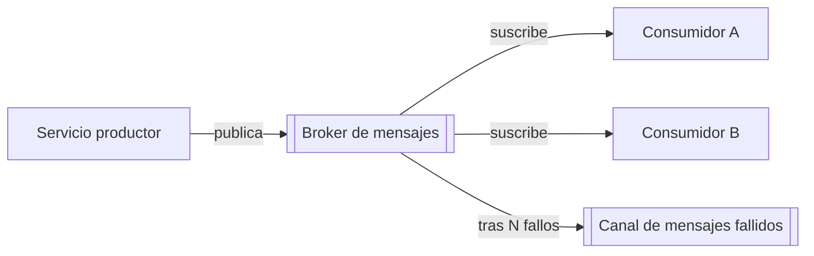

# Arquitectura de eventos

## Propósito

Describir cómo los contenedores y servicios se comunican mediante eventos y mensajes: qué eventos existen, quién los publica y consume, garantías de entrega y cómo se manejan los fallos. Es el mapa de los flujos asíncronos de la plataforma.

## Guía

- Nombra los eventos en pasado a partir de un hecho de negocio (`order.placed`, no `create_order`).
- Un único responsable publica cada tipo de evento; puede haber muchos consumidores.
- Los consumidores deben ser idempotentes: asume entrega al menos una vez salvo que se indique lo contrario.
- Los eventos llevan versión de esquema, ID único, marca de tiempo e ID de correlación.
- No incluyas secretos ni datos personales innecesarios en los payloads.
- Usa el patrón outbox (o equivalente) cuando un cambio de estado y su evento no deban divergir.

## Flujo

## Catálogo de eventos

| Evento | Productor | Consumidores | Esquema | Requiere orden |
|---|---|---|---|---|
| {{pending: dominio.hecho}} | {{pending: servicio}} | {{pending: servicios}} | {{pending: enlace al contrato}} | {{pending: sí/no, clave}} |

## Garantías de entrega

- Tipo de broker: {{pending: cola, stream basado en log o pub/sub}}
- Garantía: {{pending: al menos una vez o estrategia de procesamiento exactamente una vez}}
- Orden: {{pending: por clave, por partición o ninguno}}
- Retención: {{pending: cuánto tiempo se conservan los mensajes}}

## Manejo de fallos

| Situación | Comportamiento |
|---|---|
| Error del consumidor | Reintentar con backoff hasta {{pending: N}} intentos |
| Mensaje envenenado | Mover al canal de mensajes fallidos y alertar |
| Esquema incompatible | {{pending: rechazar o tolerar campos desconocidos}} |
| Reprocesamiento | {{pending: cómo reprocesar desde un punto en el tiempo}} |

## Observabilidad

- Métricas: profundidad de cola, retraso del consumidor, tiempo de procesamiento, mensajes fallidos.
- Trazas: propagar el ID de correlación entre productor y consumidores.

## Relacionados

- [Arquitectura de integración](integration-architecture.md)
- [Diagrama de contenedores](container-diagram.md)
- [Arquitectura de resiliencia](resilience-architecture.md)
- [Contrato de ejemplo](../07-contracts/example.md)
- [Decisiones de arquitectura](adr/README.md)
