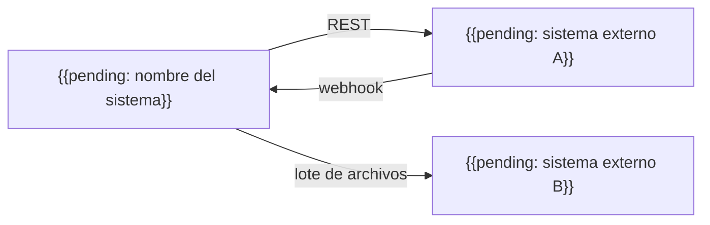

# Arquitectura de integración

## Propósito

Describir cómo el sistema intercambia datos con sistemas externos y entre sus propios contenedores: estilos, contratos, manejo de errores y responsables. Cada integración listada aquí debe tener un contrato en `07-contracts/`.

## Guía

- Prefiere un estilo de integración por caso: petición/respuesta síncrona para consultas que necesitan respuesta inmediata, mensajes asíncronos para trabajo que puede hacerse después.
- Aísla cada sistema externo detrás de un adaptador para poder reemplazarlo o simularlo en pruebas.
- Trata los datos recibidos de fuera como no confiables: valida esquema, tamaño y contenido.
- Toda llamada necesita un timeout; todo reintento necesita un límite e idempotencia.
- Versiona los contratos y mantén la compatibilidad hacia atrás durante las migraciones.

## Mapa de integraciones

## Integraciones

| Integración | Dirección | Estilo | Contrato | Frecuencia | Responsable |
|---|---|---|---|---|---|
| {{pending: sistema externo A}} | salida/entrada | {{pending: REST, webhook}} | [Ejemplo](../07-contracts/example.md) | {{pending: bajo demanda}} | {{pending: equipo}} |
| {{pending: sistema externo B}} | salida | {{pending: archivo por lotes}} | {{pending: enlace}} | {{pending: diaria}} | {{pending: equipo}} |

## Manejo de errores

| Situación | Comportamiento |
|---|---|
| Timeout | {{pending: política y límite de reintentos}} |
| Respuesta inválida | {{pending: rechazar, registrar y alertar}} |
| Sistema externo no disponible | {{pending: encolar, degradar o fallar rápido}} |
| Entrega duplicada | Tratar de forma idempotente con {{pending: clave de idempotencia}} |

## Autenticación con terceros

- Credenciales de salida: {{pending: cómo se emiten y almacenan}}
- Verificación de entrada: {{pending: firma, token o TLS mutuo}}

## Versionado

- Estrategia: {{pending: URL, cabecera o versión de esquema}}
- Ventana de obsolescencia: {{pending: duración}}

## Relacionados

- [Diagrama de contenedores](container-diagram.md)
- [Arquitectura de resiliencia](resilience-architecture.md)
- [Arquitectura de seguridad](security-architecture.md)
- [Contrato de ejemplo](../07-contracts/example.md)
- [Decisiones de arquitectura](adr/README.md)
