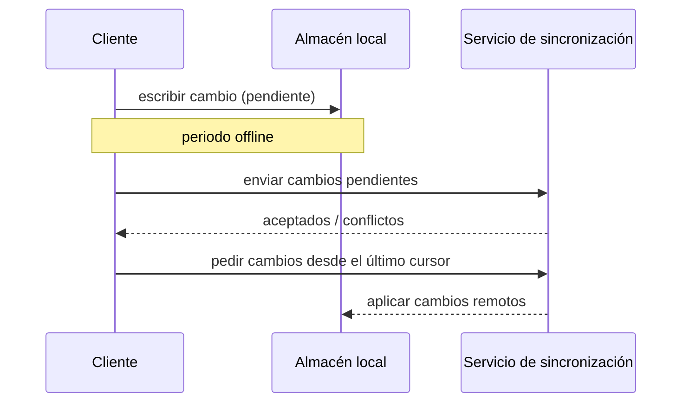

# Arquitectura de sincronización offline

## Propósito

Describir cómo los clientes siguen funcionando sin conectividad y cómo se sincronizan los cambios locales con el servidor cuando vuelve la conexión: almacenamiento local, seguimiento de cambios, resolución de conflictos y seguridad de los datos guardados en los dispositivos.

## Alcance

- Clientes que funcionan offline: {{pending: app móvil, app de escritorio, app web con service worker}}
- Funcionalidades disponibles offline: {{pending: solo lectura, crear, editar, borrar}}
- Funcionalidades que requieren conexión: {{pending: lista}}

## Flujo

## Modelo de datos para sincronizar

- Seguimiento de cambios: {{pending: versión por registro, marcas de tiempo o log de operaciones}}
- Identificadores: generados en el cliente para poder crear registros offline (por ejemplo UUID).
- Cursor de sincronización: {{pending: cómo sabe el cliente qué ha recibido ya}}
- Borrados: se propagan como marcas de borrado (tombstones) y se purgan tras {{pending: periodo}}.

## Resolución de conflictos

| Caso | Regla |
|---|---|
| Mismo campo editado en dos dispositivos | {{pending: gana la última escritura, fusionar o preguntar a la persona usuaria}} |
| Edición de un registro borrado en otro lugar | {{pending: regla}} |
| Invariante de negocio roto tras fusionar | El servidor rechaza y el cliente muestra el conflicto |

El servidor sigue siendo la fuente de verdad y revalida cada cambio recibido.

## Límites

- Periodo offline máximo soportado: {{pending: duración}}
- Cuota de almacenamiento local: {{pending: tamaño y política de expulsión}}
- Tamaño de lote por sincronización: {{pending: registros o bytes}}

## Seguridad en el dispositivo

- Cifrado de datos locales: {{pending: enfoque}}
- Qué ocurre al cerrar sesión o perder el dispositivo: {{pending: política de borrado}}
- Tokens sin conexión: {{pending: caducidad y comportamiento de renovación}}

## Relacionados

- [Diagrama de contenedores](container-diagram.md)
- [Arquitectura de integración](integration-architecture.md)
- [Arquitectura de seguridad](security-architecture.md)
- [Arquitectura de resiliencia](resilience-architecture.md)
- [Decisiones de arquitectura](adr/README.md)
