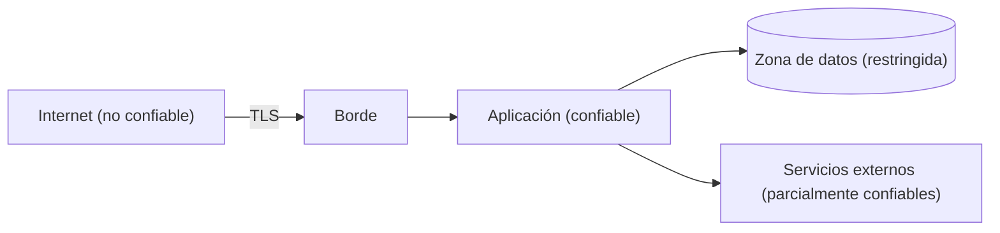

# Arquitectura de seguridad

## Propósito

Describir cómo la arquitectura protege los datos y la funcionalidad: fronteras de confianza, identidad, autorización, protección de datos y los controles aplicados en cada capa. Recoge la intención de diseño; no es evidencia de que un control se haya probado ni de que el sistema cumpla con ninguna norma.

## Principios

- Denegar por defecto; conceder el mínimo privilegio necesario.
- Validar toda entrada en la frontera de confianza por la que entra.
- Nunca confiar en el cliente para decisiones de autorización.
- Mantener los secretos fuera del código, los logs y los prompts.
- Preferir bibliotecas conocidas a criptografía propia.

## Fronteras de confianza

| Frontera | Qué la cruza | Control |
|---|---|---|
| Internet a borde | Peticiones de personas usuarias | {{pending: TLS, limitación de tasa, validación de peticiones}} |
| Aplicación a datos | Consultas | {{pending: aislamiento de red, credenciales por servicio}} |
| Aplicación a externos | Llamadas a API | {{pending: tokens acotados, timeouts, validación de respuestas}} |

## Identidad y acceso

- Autenticación de personas usuarias: {{pending: método, duración de sesión, política de MFA}}
- Autenticación entre servicios: {{pending: método}}
- Modelo de autorización: {{pending: roles, permisos o reglas por atributos}}
- Acceso administrativo: {{pending: quién, cómo y cómo se audita}}

## Protección de datos

| Clase de dato | Ejemplos | En reposo | En tránsito | Retención |
|---|---|---|---|---|
| Público | Contenido de marketing | n/a | TLS | n/a |
| Interno | Configuración | {{pending: control}} | TLS | {{pending: periodo}} |
| Personal / sensible | {{pending: ejemplos}} | {{pending: cifrado}} | TLS | {{pending: periodo}} |

## Registro y monitorización

- Eventos de seguridad registrados: {{pending: inicios de sesión, cambios de permisos, fallos}}
- Datos personales en logs: {{pending: regla de enmascaramiento}}
- Alertas: {{pending: qué dispara una alerta y quién la recibe}}

## Amenazas a tratar

| Amenaza | Componente afectado | Mitigación | Estado |
|---|---|---|---|
| {{pending: amenaza}} | {{pending: componente}} | {{pending: mitigación}} | Proposed |

## Relacionados

- [Contexto del sistema](system-context.md)
- [Arquitectura de despliegue](deployment-architecture.md)
- [Decisiones de arquitectura](adr/README.md)
- [Instrucciones para agentes](../AGENTS.md)
- [Plan de pruebas](../11-quality/test-plan.md)
