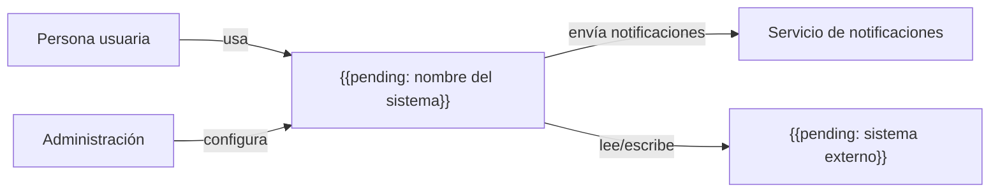

# Contexto del sistema

## Propósito

Mostrar el sistema como una sola caja rodeada de las personas y sistemas externos que interactúan con él. Es la vista de más alto nivel: fija el alcance del proyecto y las fronteras que el resto de documentos de arquitectura detallan.

## Cómo usar este documento

- Mantén el sistema como una sola caja; la estructura interna va en vistas más profundas.
- Nombra cada actor y sistema externo con un nombre neutral basado en su rol.
- Para cada relación, indica dirección, propósito y datos intercambiados.
- Actualízalo cuando aparezca un actor o integración nueva. Usa `/dixi.architecture` (Claude Code) o `$dixi-architecture` (Codex) para revisar la coherencia, y `dixi check` antes de cerrar el cambio.

## Diagrama

## Actores

| Actor | Descripción | Objetivos principales | Canal |
|---|---|---|---|
| Persona usuaria | {{pending: quién es}} | {{pending: qué necesita}} | {{pending: web, móvil, API}} |
| Administración | {{pending: quién es}} | {{pending: qué gestiona}} | {{pending: canal}} |

## Sistemas externos

| Sistema | Responsable | Dirección | Datos intercambiados | Criticidad |
|---|---|---|---|---|
| {{pending: sistema externo}} | {{pending: equipo interno o tercero}} | {{pending: entrada/salida/ambas}} | {{pending: datos}} | {{pending: alta/media/baja}} |

## Alcance

- Dentro del alcance: {{pending: capacidades que el sistema posee}}
- Fuera del alcance: {{pending: capacidades delegadas a otros sistemas}}
- Supuestos: {{pending: supuestos sobre actores o sistemas vecinos}}

## Preguntas abiertas

- {{pending: frontera o responsabilidad sin resolver}}

## Relacionados

- [Visión](../01-business/vision.md)
- [Especificación maestra](../00-master-spec.md)
- [Arquitectura de despliegue](deployment-architecture.md)
- [Arquitectura de seguridad](security-architecture.md)
- [Decisiones de arquitectura](adr/README.md)
- [Contrato de ejemplo](../07-contracts/example.md)
