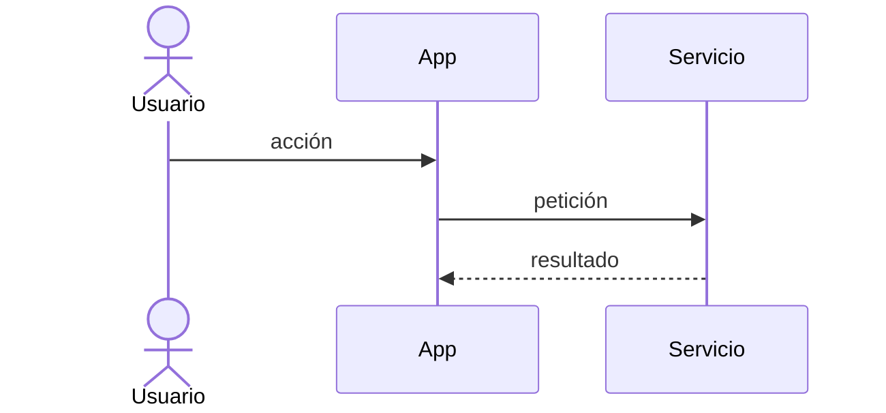

# Plantilla de flujo

## Propósito

Describir un proceso que cruza pasos, actores o módulos: el camino feliz, las alternativas, los
errores y los eventos que emite. Copia la estructura de abajo para cada flujo de negocio relevante.

## Plantilla

````markdown
# Flujo: <nombre del flujo>

ID: {{pending: ID del flujo}}
Features relacionadas: FEATURE-NNN
Responsable: {{pending: persona responsable}}

## Descripción

Qué logra el flujo y quién lo inicia.

## Precondiciones

- ...

## Flujo principal (camino feliz)

1. El actor hace ...
2. El sistema valida ...
3. El sistema registra ... y emite `<evento>`.

## Diagrama



## Flujos alternativos

- FA-1 <nombre>: en el paso N, si ..., entonces ...

## Manejo de errores

| Paso | Error | Comportamiento | Código de error |
|---|---|---|---|

## Eventos emitidos

| Evento | Paso | Consumidores |
|---|---|---|

## Integraciones

| Sistema externo | Paso | Política de timeout y reintento |
|---|---|---|

## Postcondiciones

- ...
````

## Notas

- Cada fila de alternativa y de error se convierte en al menos una prueba.
- Notación de diagramas: {{pending: notación de diagramas que usa el proyecto}}

## Relacionados

- [Plantilla de dominio](domain-template.md)
- [Plantilla de módulo](module-template.md)
- [Estándar de manejo de errores](../error-handling-standard.md)
