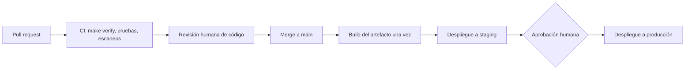

# Visión general de CI/CD

## Propósito

Describir el camino que sigue cada cambio desde un commit hasta producción: qué comprobaciones corren, dónde aprueban las personas y qué nunca se automatiza. Esta área documenta la entrega; no contiene infraestructura, configuración de proveedores ni archivos de cuentas.

## Principios

- Un build por commit; el mismo artefacto se promueve entre entornos, nunca se reconstruye.
- `make verify` es la compuerta obligatoria: si falla, nada avanza.
- Una persona aprueba cada promoción a producción. Nada se despliega automáticamente a producción sin revisión.
- La definición del pipeline se versiona en el repositorio y se revisa como código.
- Los pipelines nunca imprimen secretos; los leen en tiempo de ejecución del almacén elegido en el documento de gestión de secretos.

## Flujo

## Etapas y compuertas

| Etapa | Disparador | Compuerta para pasar | Quién decide |
|---|---|---|---|
| Integración continua | Pull request abierto o actualizado | `make verify` y `dixi check` en verde, pruebas pasan | Automático |
| Revisión de código | CI en verde | {{pending: número de aprobaciones requeridas}} | Revisor/a |
| Build | Merge a main | Artefacto construido y etiquetado con el identificador del commit | Automático |
| Staging | Build exitoso | Pruebas de humo pasan | {{pending: automático o manual}} |
| Producción | Staging verificado | Aprobación explícita registrada | {{pending: rol}} |

## Decisiones

- Servicio de CI: {{pending: decidir y registrar en un ADR}}
- Modelo de ramas: {{pending: trunk-based u otro}}
- Tipo de artefacto y registro: {{pending: decidir}}
- Cadencia de versiones: {{pending: bajo demanda, diaria, semanal}}

## Qué pueden y qué no pueden hacer los agentes

Los agentes pueden preparar cambios, ejecutar `make verify` y redactar notas de versión (por ejemplo con `/dixi.release`). Nunca aprueban, hacen merge ni despliegan en nombre de una persona.

## Relacionados

- [Entornos](environments.md)
- [Estrategia de despliegue](deployment-strategy.md)
- [Estrategia de reversión](rollback-strategy.md)
- [Arquitectura de despliegue](../09-architecture/deployment-architecture.md)
- [Escalera de verificación](../11-quality/verification-ladder.md)
- [Gestión de secretos](../13-security/secret-management.md)
